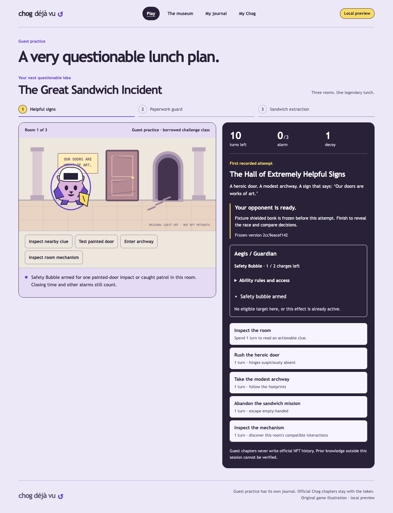

# Twelve tactical adventurers — October 11, 2026

Implemented on top of the existing Chog Déjà Vu game. The user explicitly approved bounded NFT-holder advantages, superseding the prior equal-power contract. [CHARACTER_RULES.md](CHARACTER_RULES.md) defines exact eligibility/costs/durations and [CHARACTER_ASSETS.md](CHARACTER_ASSETS.md) records original artwork. This is still one three-room sandwich adventure with asynchronous ghosts and a consented failure museum.

## What works

All twelve classes have functioning, server-validated signature skills: Pip/Peek, Bolt/Shortcut, Patch/Spare Parts, Moss/Calm Down, Aegis/Safety Bubble, Nyx/Shadow Step, Echo/False Trail, Prism/Truth Lens, Atlas/Steady Hands, Flux/Reroute, Ember/Breakthrough and Mneme/Second Thought. Four starters have one charge. Eight current-owner classes have two. All begin with ten turns and one basic decoy, inventory cap one; NFT rarity/count never stack power. Holders selecting a starter still get one charge. Every starter finishes both generated patrol phases through the preserved non-ability route.

The first Pip/Patch/Aegis/Echo slice passed 86 unit/integration tests plus two new browser flows before the remaining eight were completed. Those browser flows exercised original portraits, real actions, persisted charges, synthetic verified-provider/owner requests, holder challenge borrowing and transfer-away/back rejection. Intermediate work was not represented as the completed twelve-class target.

`/play` has a native expandable character roster, four selectable starter radios, eight locked classes and exact ability descriptions. `/character` preserves Privy and explicit chapter grants; verified holders select all twelve for official chapters. Existing legacy chapters remain visible and replayable. The scene renders the selected adventurer and moves it according to authoritative events. Real room-interaction buttons call the same action endpoint as tactical controls. The hatch, patrol gate and pressure plate have visible authored treatments. Bubble/trail/handling/reroute states, remaining resources and unresolved commitments are displayed. Rule details remain accessible in a native disclosure.

Mneme records commit-door/commit-sneak/commit-take at zero turns, then a separate Confirm resolves the ordinary action. Second Thought records a charge spend and cancellation before resolution. No already-revealed result or old event can be undone. Aegis protects only a painted impact or caught patrol; it grants no passage, universal immunity or closing-time rescue. Flux expires on the next resolved ordinary action, including a wasted unrelated action. Atlas preparation grants no sandwich by itself. Illegal or exhausted skills spend nothing.

## Contracts, privacy and legacy behavior

New first-party starts send a character ID and freeze character-definitions/1, ability-rules/1, sandwich-rules/2, sandwich-rooms/2 and seed-parity/1. Scenario snapshots include the initial loadout. Actions and current tactical state persist transactionally; tactical state includes charges, active effects, pending choice and validated events. Reads compare it with deterministic replay. Duplicate steps acknowledge the existing result without another effect. At most 32 events accommodate zero-turn skills and commitment/cancellation, while actual mission time remains ten turns.

Version 1 records hydrate with null tactical state, never an invented class. Their original transition and habit-ranking/1 decisions remain selected by version. Shared closing-budget and completed-training ingestion preserve the original outcomes; one simulation loop dispatches the frozen policy. Existing clients omitting a character still use the explicit v1 compatibility path. Legacy retry/race/exhibit starts retain their original scenario and policy; choosing a new class starts a new version 2 chapter. Existing private/public chapters, withdrawals and transfer-safe history remain.

Habit-abilities/2 observes only legal current choices, permitted clues/patrol information, remaining charges and prior recorded support. It learns room-specific ability timing, inspections, route/gadget patterns and commitments. Tests show different supported timing histories producing different initial choices. Training and pre-attempt rivals stay within matching rules and loadouts; the current attempt cannot train its frozen opponent. V2 official rematches now freeze the current keeper's own matching prior ghost. Player and ghost use separate world/resource copies. A spent-turn race coalesces zero-turn preparation into a clock tick; exact replay retains every event.

A public museum challenge copies its frozen scenario, class, charge budget and ghost server-side. A guest may borrow a holder class only there. It grants no official identity or reusable class privilege. Personal races of a borrowed holder chapter remain bound to the original active exhibit; borrowed holder chapters cannot be republished as independent holder-class exhibits. New borrowing ends on withdrawal; already-started private attempts may finish, while original public comparison/opponent access disappears. Public chapter ghosts still use only the consented chapter, excluding private training/actor/session IDs. Challenge progress keeps exposure cohorts and different loadouts separate. Familiarity follows the same authored mission across v1/v2; a version change does not prove a blind attempt.

Privy provider proof, SIWE nonce/domain/chain/wallet/expiry, current-owner reads, ownership generations and successor privacy are retained. There is no client holder flag. Optional server-only `CHOG_PRIVY_SERVER_APP_ID` defaults to the built public App ID; if configured live, it must match the frontend app. The test server uses its own fixture App ID and disposable ES256 public key, avoiding dependence on any live Privy key. No live credentials were changed. Every official start/action/publication still rechecks ownership; provider/RPC failure authorizes no holder action and leaves guest starters usable.

## Verification

Node 24.19.0; no new dependency or missing tool installed. The old temporary Playwright browser cache had gone, so browser tests use the already-installed Chrome in isolated test profiles via `CHOG_E2E_BROWSER_CHANNEL=chrome`. Synthetic ownership/provider keys and disposable SQLite are restricted to the test runner, not production routes.

- `npm run format:check` — pass.
- `npm run lint` — pass.
- `npm run typecheck` — pass.
- `npm test` — 119 pass across 20 suites; one opt-in live RPC test skipped.
- `npm run build` — pass; the existing optional Farcaster Solana module and viem/Ox Tempo bundler warnings remain.
- `CHOG_E2E_BROWSER_CHANNEL=chrome npm run test:e2e` — 24 production browser flows pass.
- After resetting screenshot scroll position, `CHOG_E2E_BROWSER_CHANNEL=chrome npm run test:e2e -- tests/e2e/characters.spec.ts -g 'synthetic verified holder'` — pass again; inspected the refreshed screenshot. The scene is aligned with its controls, with Safety Bubble visibly armed. This uses only disposable fixture ownership/provider evidence.

Saved raw results: [unit/integration](evidence/chog-characters-final-unit.txt), [full browser suite](evidence/chog-characters-final-browser.txt), [final visual flow](evidence/chog-characters-evidence-check.txt), [Desloppify status](evidence/chog-characters-evidence-status.txt), [Desloppify next](evidence/chog-characters-evidence-next.txt). Local `/play` returned HTTP 200 after verification.

Coverage includes every materially working ability, legal target validation, exhaustion/resource bounds, terminal rejection, duplicate effects, exact replay, legal ability-using ghosts, independent resources, timing support, legacy hydration, class/version mismatch, cross-budget comparison separation, real HTTP forged-holder/extra-budget rejection, synthetic JWT+signature/owner access, non-owner and RPC rejection, away/back revocation, refresh/reconnect, borrowed-loadout scope, withdrawal, journal/race preservation and original navigation. Existing expired/replayed-signature, reorg, provider-token and inherited-public-history/private-draft tests pass. Moss's browser setup follows the visible patrol phase rather than assuming a seed.

Axe reports zero A/AA violations in the exercised roster/guest/result/race states. Browser checks include keyboard activation, 320px play/reflow, enlarged text, reduced motion and existing forced-colors focus. This is not a full accessibility certification. VoiceOver/NVDA, native browser zoom and consenting human feedback are unverified. Normal local preview inspection recovered the existing saved legacy chapter without changing its actions or publishing anything.

[Full twelve-character roster screenshot — local automated fixture](evidence/character-roster-fixture.png)

## Remaining limits and real-holder manual test

No user-operated holder sign-in/signature/play has been observed. Synthetic fixtures prove the tested validation paths, not real NFT ownership. Contract wallets remain unsupported/unverified as before. Public history is application-layer data; no NFT metadata or original contract is modified. Human balance/fun testing remains pending. Some two-charge classes have only one eligible traversal/objective target in this mission; two charges are a cap, not a promise of two useful targets. No PvP/matchmaking, leaderboard, breeding, trading, staking, monetary rewards, broad open world or arbitrary AI rules were added.

To test with a consenting real holder:

1. Keep the real `NEXT_PUBLIC_PRIVY_APP_ID` configured and local origin allowed in its dashboard. Leave `CHOG_PRIVY_SERVER_APP_ID` unset, or match that exact app. Use the existing JWKS mode; do not copy test keys into live configuration. Open `http://127.0.0.1:3000/character`.
2. Choose Sign in with Privy yourself, select your Ethereum wallet and Monad Mainnet (143), and enter an actually owned allowlisted Chog Genesis token ID. Display name CHOG #1737 is token **276**; use 276 only if your wallet owns that token.
3. Prepare the chapter grant, review the nonce/domain/chain/token/expiry message and explicitly sign it in your wallet yourself. It is a message, not an NFT transfer or spending approval.
4. After the owner grant appears, open Change character, choose Aegis and start an official chapter. Verify two charges. Use Safety Bubble, then Rush the heroic door: stay in the hall, spend one turn and consume the bubble. Continue through the archway. Refresh and check resources persist. A starter selected by a holder must still show one initial charge.
5. Finish, inspect the exact replay and ghost, then retry the frozen scenario. Publication is optional and requires the explicit consent control. If you choose to publish a failure to the museum, another guest context should borrow that exact loadout, never general holder access. Withdrawal should remove the public challenge/comparison.
6. For rejection, use a consenting non-owner's own wallet and check that a token grant/official holder start is unavailable. Outage/transfer/reorg checks remain labelled automated fixtures; do not transfer a real NFT just for a demo.

No purchase, transfer, deployment, commit, push, app registration, agreement acceptance, spending or agent-performed user-wallet signature occurred. Publishing/deploying/submitting or conducting a real asset transfer still needs explicit authorization. The user-reported October 23 15:00 UTC / 16:00 WAT cutoff is countdown inference; target October 22 and confirm the organizer's actual cutoff before submission.

## Files changed

- `src/domain/characters/definitions.ts`; `src/domain/abilities/{eligibility,apply,starter,holder}.ts`.
- `src/domain/game/{actions,contracts,engine,legacy,budget}.ts`; `src/domain/game/tactical/{contracts,clues,commitment,effects,engine}.ts`.
- `src/domain/ghosts/{contracts,legacy,policy,abilities,abilitySupport,abilityPreferences,training}.ts`; `src/domain/{views,journal}.ts`.
- `src/server/{characterAccess,rivals,runs,persistence,journal,http,identityHttp,official}.ts`.
- `src/components/characters/{Portrait,Selection,AbilityStatus,RoomInteractions,SceneMechanisms,startRequests}` and `src/app/characters.css`, root layout.
- Moved Adventure, Controls, Stage, Replay, RaceReplay and Result into `src/components/adventure/`; updated Museum, OfficialExperience, guest PlayScreen/Journal/useGuestGame, useOfficialGame, PublicChapters, ChapterReview and the landing illustration imports.
- Added four ability/presentation/boundary unit suites and the character persistence integration suite; expanded HTTP tests and 11 character browser flows. Updated moved-component test imports, browser fixture runner/RPC/provider helper and Playwright config.
- `.env.example`; README, START_HERE, PLAN, GAME_SPEC, ARCHITECTURE, PRIVY, PROGRESS, EVENT_AND_SUBMISSION; this report, CHARACTER_RULES, CHARACTER_ASSETS and screenshot evidence. Actual `.env`/`.env.local`, user database and AGENTS are preserved.

## Desloppify

Project-scoped scan/status/next ran before implementation and after the final code. Dependency, generated build/cache/browser/worktree output and local database exclusions remain explicit; authored engine/content/API/tests are included. No suppressions, artificial ratings or wontfix decisions were used. The new contract cycles, duplicate simulator/ingestion/budget code, large branching eligibility/policy functions and component-directory overload were resolved through cohesive modules and the real regression suite. Legacy behavior remains covered.

Final scores: overall **21.8**, objective/verified **87.1**, strict **20.6**. Before this milestone they were 21.6, 86.3 and 20.8 respectively. Mechanical health improved, but strict health decreased slightly; the **85 target is not met**. Twenty subjective dimensions remain unassessed, so there is no defensible subjective quality rating yet. `desloppify next` requests that initial review.

The scan retains 120 open findings: 61 test-coverage findings, 34 smells, 20 subjective reviews, three single-use abstractions, one existing Playwright orphan/config finding and one test-file naming convention finding. Import-based test coverage does not recognize all API/browser execution; isolated hook coverage also remains incomplete. Two new hardcoded loopback URLs belong to the isolated browser fixture. These remain reported rather than suppressed. No open import cycles or duplicate-code findings remain. Test health is the principal mechanical gap (41.4 health / 23.9 strict). A broader health campaign is a separate next gate; this feature milestone does not claim that repository-wide debt is resolved.
