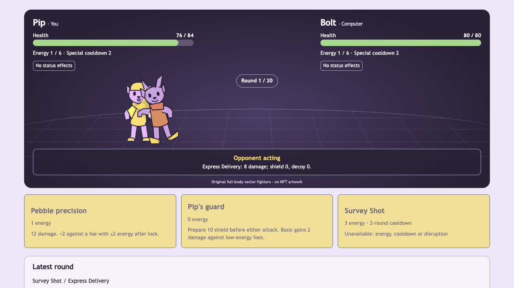

# Combat-first playable milestone — October 11, 2026

**Current October 13 update:** [ARENA_3D.md](ARENA_3D.md) supersedes the flat combat artwork and visible-history/announcement layout described below. All twelve rendered families, full viewport active arena, queued three-second notices and post-match history are implemented. The earlier implementation/test records below remain historical; rules, policy versions and identity protections are unchanged.

**Current October 12 update:** [COMBAT_PRESENTATION.md](COMBAT_PRESENTATION.md) supersedes presentation/opponent-policy details below. Twelve distinct anatomies and 24 move treatments, frozen Easy/Medium/Hard `/2` policies, honest Legacy `/1` replay, 187 tests/38 browser flows and recordings are verified. The October 11 implementation/test results below remain historical. Gameplay stats, ownership, separate persistence and adventure contracts are preserved. Current NFT combat utility is holder access and private token-associated records; progression/loadouts/combat ghosts remain unimplemented.

The user explicitly superseded the previous adventure-first lock. AGENTS, START_HERE, README, PLAN, GAME_SPEC and ARCHITECTURE now identify creature battles as primary. The sandwich adventure, asynchronous ghosts, journal, museum, consent withdrawal and token identity remain secondary working experiences on their existing routes. No old chapter acquires invented combat fields.

## Implemented and playable

Landing → `/arena` → fighter selection → paired turn battle → result → rematch. Four guest starters and eight verified-holder classes have complete combat kits: Pip, Bolt, Patch, Moss, Aegis, Nyx, Echo, Prism, Atlas, Flux, Ember and Mneme. Every class has its own basic, special, guard and passive contract. Definitions and exact stats are in [COMBAT_RULES.md](COMBAT_RULES.md); tall original full-body models and provenance are in [COMBAT_ASSETS.md](COMBAT_ASSETS.md).

The first Pip-versus-Bolt slice passed four pure-rule tests and a complete production browser battle (attack/defence/special, refresh, result/rematch) before completion of the broader roster verification. Four starters each have a tested winning strategy against the intended Bolt opponent with both reproducible tie identities. All twelve kits are exercised in the resolver; all twelve can start and execute an official special under a labelled internal authority fixture. HTTP/provider/current-owner and browser fixture tests separately check the protected boundary. This does not represent a real holder signing or playing.

Players submit only intended basic/guard/special moves and round ordinals. The server owns resources, legality, paired choices, ordering, damage, statuses, cooldowns and outcomes. The computer chooses and persists its move from public pre-round state before the player submits. Its pending move/reason stay server-only until reveal; a reconnect does not reroll them. Policy preferences differ by fighter and use public resources and completed moves. This is deterministic policy, not an LLM, machine learning or cryptographic fairness.

Both defences prepare before initiative. Ties alternate reproducibly using fixed tie identity 0 for new server matches. Attacks execute in order; a knockout cancels an unexecuted attack. Armour, shields, finite decoys and readable dodge rules mitigate hits. Burn resolves simultaneously at round end; simultaneous knockouts or reaching 20 surviving rounds draw. Energy/cooldowns/status durations are explicit, bounded and independent of the old adventure charge budgets. NFT count/rarity never stack power.

The arena has two prominent full-body fighters, numeric health/energy/cooldowns, public effect durations, action names/costs, active-fighter announcements, a concise latest-round log and an expandable exact event log. Physical fighters approach/impact/react/return; ranged attacks launch projectiles; shield, heal, status and knockout frames come from resolved events. Health displays change at the corresponding impact frame. Controls lock through network acknowledgement and playback; no invented thinking delay. Move selection scrolls to the arena immediately so its health bars stay visible. Reduced motion shortens the sequence; keyboard and narrow mobile controls use the same engine.

## Persistence and access

A separate additive SQLite `battles` table stores frozen fighter/move/rule/policy snapshots, both initial definitions, current state, accepted choices, resolved event frames, pending computer choice, actor/mode and optional official authority. Reads reproduce rounds and verify stored state/policy. Unsupported versions, altered resources or corrupted pending choices fail closed. Start IDs are idempotent for the same loadout. Matching repeated round intent returns the result without another hit; conflicting/stale/future rounds fail. Rematches create new records rather than resetting old health. One active match per current mode/token grant prevents disconnect rerolls.

Guest practice is independent of Privy/RPC availability and cannot select holder fighters. A computer using a holder class is game content, not an ownership claim. The guest arena does not inherit the adventure museum's challenge-only borrowing privilege.

Official combat appears directly after the existing My Chog grant. Adventure selection/publication is available in its secondary disclosure. The existing Privy adapter, proof verification, EOA nonce-bound grant and fresh current-owner/generation checks authorize every official start/round, including repeated requests. Missing proof, non-owner, stale/revoked generation and unavailable RPC evidence reject writes. Shared provider/session and same-origin/JSON helpers retain the same identity boundaries. Original private/public adventure records and consented inherited history are preserved.

Combat history is private by default and stored separately by actor and guest/official mode. Each official battle records its token identity/generation; the current owner controls new writes. Private battles do not become successor-visible public history. This milestone adds no combat publication/museum/ranking endpoint and does not change the NFT contract or metadata. Existing adventure publication and author withdrawal still work.

## Verification

Bundled Node 24.19.0. No dependency, browser or tool installation. Existing installed Chrome runs the browser suite in isolated profiles; TLS remains verified through a disposable fixture CA. Tests never use the user's signing key or transfer an NFT.

- `npm run format:check` — pass.
- `npm run lint` — pass.
- `npm run typecheck` — pass.
- `npm test` — 165 pass across 25 suites; one opt-in live RPC test skipped.
- `npm run build` — pass. Existing optional Farcaster Solana peer and viem/Ox Tempo bundler warnings remain.
- `CHOG_E2E_BROWSER_CHANNEL=chrome npm run test:e2e` — 29 production browser flows pass after the final request lifecycle, arena visibility and identity-module changes (1.2 minutes).

Tests cover every kit's actual material effects, passive triggers, legal targets/resources, damage/mitigation, defence ordering, initiative/ties, costs/recovery, cooldown/expiry, counter and healing bounds, cancelled attacks, simultaneous end-round outcomes, stalemate, deterministic replay and stored corruption. Computer pending choice is checked against the pre-round policy and does not receive current intent. Both tie fixtures let every starter win Bolt. Separate storage tests verify actor/token-generation scopes and byte-for-byte preservation of a legacy adventure/exhibit. Actual signed disposable Privy proof and wallet grants exercise missing/mismatched proof, non-owner, RPC outage and away/back rejection even on duplicate official intent. Modified client stats/damage are rejected by strict HTTP schemas.

Browser combat flows include landing/selection, prominent fighters, attack/defence/special, opponent action, resource change, result/rematch, refresh, lost-reply retry, leaving during visible action, 320px keyboard/reduced motion and synthetic holder/RPC/transfer boundaries. All original adventure character, race, journal, museum, consent and navigation regressions remain in the full suite. Axe reports zero A/AA violations in exercised combat states; human screen-reader/native-zoom testing is not complete.

Raw final command logs and rendered screenshots are saved under `docs/evidence/`. No test count or screenshot is usage, feedback or real-holder evidence.

## Balance and remaining limits

This is a local single-player deterministic arena with provisional authored balance. Starters can win the supported Bolt encounter; no all-matchup parity or human enjoyment claim is made. Heavy/armoured holders can be strong; slow initiative, energy/cooldowns, dodge exceptions and Ember recoil are their declared weaknesses. Computer patterns are deliberately understandable and may be exploitable. Human tactical variety/fun and broader matchup balance need consenting playtests.

No real user-operated Privy holder login, grant signature or combat session has been observed. EOA-only signatures remain; contract wallets are unsupported. There is no real-time PvP, matchmaking, ranked ladder, combat ghost training, combat publication, breeding, trading, staking, token rewards or arbitrary AI game rules. Adventures retain their existing ghost/museum loop. Local SQLite needs durable Node storage for deployment; this is not a deployed release. Losing a guest cookie loses access to that private history. Native screen readers, cross-browser animation timing and actual holder SDK interaction remain manual gates.

## Real-holder manual test

1. Keep the existing real public Privy App ID configured, local origin allowed and identity tokens enabled. Use JWKS mode. Leave server-only `CHOG_PRIVY_SERVER_APP_ID` unset or match the real frontend app; never copy fixture keys into live settings. Open `http://127.0.0.1:3000/character`.
2. Sign in through Privy yourself with a connected Ethereum wallet on Monad 143. Enter an actually owned allowlisted Chog Genesis token ID. CHOG #1737's blockchain token ID is 276; use 276 only if you own it. Prepare the existing chapter grant, review origin/chain/token/nonce/expiry and sign it yourself. This is a message, not an NFT transaction or spending approval.
3. The official combat selection appears when the grant is valid. Choose Aegis and computer Atlas; start an official battle. Verify 100 initial HP, armour 3, speed 4 and energy 4/6. Click Defence: the shield must prepare before slow Atlas's special, health changes at impact and a surviving eligible hit triggers a bounded counter. Observe numeric health and the event log.
4. Use legal basic/special moves, check costs/cooldown and refresh after a round. HP, energy, effects, pending opponent and round must restore without a duplicate hit. Complete to victory/defeat/draw, rematch and verify a new battle starts with fresh resources while the old result remains in private official history. Return to selection; all twelve are available. A holder choosing a starter receives that starter's unchanged combat stats, not an adventure charge advantage.
5. Visit `/arena` in an independent guest context. Only four player starters are available, even though the computer may use any class. Guest battles must not appear in official token history. A consenting non-owner can sign in as themselves but cannot create an official battle for another wallet's token. Check preserved adventure/public-history/withdrawal controls using a chapter you actually consented to publish; combat itself is not automatically public.
6. No NFT transfer is needed for testing. Outage, transfer/reorg and signature-expiry/replay boundaries are covered by labelled automated fixtures; do not manufacture a live transfer demo. Human signatures, publication or external submission remain user actions.

## Files changed

- Added `src/domain/combat/{contracts,definitions,moves,policy,round,damage,specials,endRound,engine}.ts`.
- Added `src/server/combat/{persistence,service,reader,http}.ts`, `/api/battle`, `/arena` and `src/components/combat/{FighterArt,Equipment,Selection,Arena,Screen,Official,playback,usePlayback,useCombat}`.
- Added four cohesive combat CSS files and root layout imports/metadata. Landing and shared navigation now lead with Arena, retaining `/play` and legacy challenge links. Removed the now-unused static landing-only HeistIllustration; active adventure/replay artwork is unchanged.
- Shared `server/auth/{request,runtime}` and same-origin/JSON validation with the identity API. Moved the existing official/identity UI and wallet helpers together into `components/identity` and updated imports; preserved their behavior and grant stack.
- Added combat engine/fighter/presentation and persistence/HTTP tests plus five browser combat flows. Updated the fixture helper to address either existing identity or battle APIs; updated old navigation assertions to the deliberate Adventure label.
- Updated AGENTS, START_HERE, README, PLAN, GAME_SPEC, ARCHITECTURE, CHARACTER_RULES, PRIVY and PROGRESS; added COMBAT_RULES, COMBAT_ASSETS and this evidence report. Actual `.env`/`.env.local`, private records and old adventure schemas are preserved.

No subagents, dependencies, purchases, transfers, deployments, commits, pushes, paid services or agent-performed user-wallet signatures. Deployment and final event submission require explicit authorization; the previously reported October 23 countdown inference still needs an organizer-confirmed cutoff.

## Desloppify

Project-only scan/status/next ran before and after code with the existing explicit dependency/build/cache/browser/database/worktree exclusions. Authored combat/identity/engine/API/tests remain included. No suppressions, unjustified exclusions, wontfix decisions or invented subjective scores.

Before: overall **21.8**, objective/verified **87.1**, strict **20.6**, 120 open findings. Final: overall **22.2**, objective/verified **88.9**, strict **21.0**, 142 open findings. The **85 strict target is not met**; twenty subjective dimensions remain unassessed. `next` still requests the initial subjective review. Mechanical health improved, while test-health strict coverage is still weak (44.0 health / 21.9 strict).

Remaining findings: 73 import-based coverage items, 43 smells, 20 subjective reviews, three single-use abstractions, one existing Playwright orphan/config finding, one test naming-convention finding and one carried signature finding for the removed `finish` function. Source inspection confirms no `finish` remains in the combat engine; this scanner item is reported, not hidden. Transitive engine helper and browser-tested UI hooks are not recognized as directly covered; isolated hook unit coverage also remains incomplete. New framework hook closure/complexity and isolated fixture URL/expiry/corruption-test assertions remain in the scanner queue. No new open cycles, duplicated code, directory-overload or security findings remain.

Relevant complexity/duplicate code and directory overload were addressed through separate round completion, pure presentation frames, one battle request lifecycle, shared identity boundaries and cohesive identity UI/style modules. No claim of repository-wide health completion is made.

Raw results: [unit/integration](evidence/chog-combat-tests.txt), [browser](evidence/chog-combat-browser.txt), [build](evidence/chog-combat-build.txt), [lint](evidence/chog-combat-lint.txt), [types](evidence/chog-combat-types.txt), [format](evidence/chog-combat-format-check.txt), [Desloppify status](evidence/chog-combat-final-status.txt), [next](evidence/chog-combat-final-next.txt).

[Desktop arena](evidence/combat-pip.png) · [320px keyboard/reduced-motion gameplay](evidence/combat-mobile.png) · [combat-first landing](evidence/combat-landing.png)
