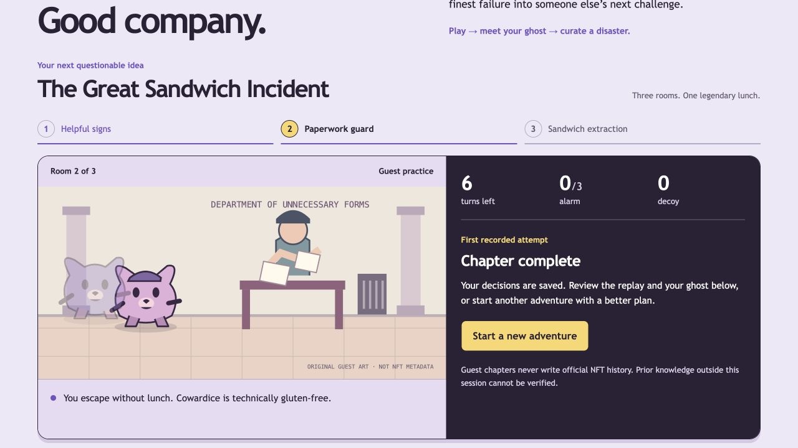

# Museum after hours — design pass

**Current identity — October 14, 2026:** [the complete game rebrand](REBRAND.md) and [shared design system](GAME_IDENTITY.md) supersede earlier palette, typography, hero copy and decoration described here. Approved rendered artwork and existing functionality remain preserved.

## Approved combat direction — October 12, 2026

Active battles fill the dynamic viewport: no site header/footer/introduction, long rules or visible history. Two large sculpted 3D-looking fighters face each other over a separate lavender sandstone arena. Each has the approved animal companion; companions participate only in existing specials with no extra HP/turns/damage. Compact HP/energy/cooldown/status HUD, three move buttons and settings are persistent. Executed move notices queue top-right for three seconds independently of combat timing; detailed history is opt-in after the compact result overlay.

Production approach: generated transparent rendered pose atlases, separate companion layers and event-driven motion/effects. These are rendered images, not rigged 3D models. First acceptance slice: Aegis/armadillo versus Ember/phoenix through the authenticated synthetic-holder workflow without guest access bypass. Expand after this slice passes. Preserve approved supporting-material references; no Kuroro/NFT art. See [ARENA_3D.md](ARENA_3D.md) for implementation/evidence.

Source request: [Orezi Mena's UI Skills post](https://x.com/Thecreativemena/status/2108101084153606198). Read October 10, 2026. It links to [UI Skills](https://www.ui-skills.com/), a catalog rather than one prescribed visual theme.

Selected guidance: [frontend-design](https://www.ui-skills.com/skills/anthropics/frontend-design), [better-ui](https://www.ui-skills.com/skills/jakubkrehel/better-ui), and [better-accessibility](https://www.ui-skills.com/skills/jakubkrehel/better-accessibility). These were read directly from their published catalog pages; no global skills, agent settings or MCP servers are installed by this pass. The catalog router guided selection. The catalog CLI was also invoked for discovery.

## Plan before implementation

The subject is a comic museum heist with a habit ghost and consented failures. The strongest visual is the playable room, paired with obvious choices. Give it a lilac museum wall, a dark ticket-like control panel and yellow admission accents. Keep the hero compact so the game is immediately discoverable. Room numbers represent the actual three-room sequence; exhibit cards represent actual published failures only.

| Token            | Value   | Role                                  |
| ---------------- | ------- | ------------------------------------- |
| Ink              | #292137 | Text, outlines, control panel         |
| Gallery lilac    | #ede8f8 | Page background                       |
| Paper            | #ffffff | Quiet reading surfaces                |
| Admission yellow | #f7db65 | Primary actions and playful signage   |
| Ghost violet     | #6a4bc6 | Secondary emphasis and ghost identity |
| Muted ink        | #655c75 | Secondary copy with measured contrast |

Typeface: Trebuchet MS with Arial/sans-serif fallback, chosen for rounded, slightly mischievous shapes and readable tactical text. Bold compact display type and regular body copy use one family. No network font request or copied collection art. Body 16px; action labels 15px; support copy at least 13px. Numbers use tabular spacing.

Desktop structure:

```text
wordmark                  play / museum / character       guest label
compact comic headline                 purpose and how-to-play copy
adventure title                     three-room progress
illustrated room / consequence      budget / clue / choices
completed chapter: replay           strategy ghost / publish
museum: real exhibits or an invitation to make the first
official character verification state
```

Mobile stacks the same reading order, scales the artwork modestly, and retains readable choice hints and 44px controls. Quiet panels use concentric spacing; the stage/control pair is the memorable surface. No fixed overlays or automatic moving decorations.

## Critique and revision

The previous hero's serif/cream treatment and repeated tiny uppercase labels read as a general presentation template. Replace them with a compact sans headline, larger sentence-case labels and a playable room as the visual anchor. Avoid accenting one phrase of the headline, decorative arrows on every button, invented counters, and generic three-card feature sections. Keep rules and consent accessible, but put developer policy/version details in expandable explanations rather than dominating the player's next action.

Verification: run gameplay/replay/publication browser flows, keyboard activation, 320px reflow, 200% text enlargement, forced-colors focus, reduced motion, control sizing, and an automated accessibility audit. Record any unverified screen-reader behavior honestly. Preserve all guest/official distinctions and frozen scoring behavior. Do not change the engine or ownership gates for visual purposes.

## Implemented review

Applied the published guidance to the existing CSS and React views. No UI framework, remote font, generated bitmap or copied NFT art was introduced. The only new project dependency is `@axe-core/playwright` for development-time accessibility checks, pinned in the lockfile. The UI Skills CLI loaded the selected guidance into temporary files; it did not install global skills or change agent settings.

| Severity | Location                                       | Before                                                                          | After                                                                                                   | Why                                                                                                               |
| -------- | ---------------------------------------------- | ------------------------------------------------------------------------------- | ------------------------------------------------------------------------------------------------------- | ----------------------------------------------------------------------------------------------------------------- |
| LOW      | src/app/globals.css, src/app/layout.css        | Serif/cream hero, small repeated uppercase labels                               | Lilac gallery, bold sans headline, sentence-case labels, quieter hero                                   | Subject-specific hierarchy; typography recommendations, not a claimed WCAG minimum font size                      |
| LOW      | src/app/play.css, src/components/Adventure.tsx | Current-room text alone, small hints                                            | Explicit three-room progress, readable 13px hints and a dark control surface                            | Visible sequence and more legible next actions; current state also has text/ARIA, not color alone (1.4.1)         |
| LOW      | src/app/globals.css                            | Hover translation on every pointer, no press feedback                           | Hover gated to hover-capable pointers; 0.96 press scale over 150ms only without reduced motion          | Avoid latched touch hover and respect motion preference; static colors/labels remain                              |
| MEDIUM   | src/components/Game.tsx, src/app/globals.css   | No skip link                                                                    | First-focusable skip link targets the focusable adventure section                                       | Bypass repeated navigation (2.4.1); actual Tab/Enter path tested                                                  |
| LOW      | src/components/Result.tsx                      | Disabled submit before consent, developer version text in the main reading flow | Native required-checkbox validation focuses consent on submit; frozen version details inside disclosure | Keeps consent discoverable and explicit; server rejection of missing consent remains enforced                     |
| LOW      | src/app/globals.css, src/app/play.css          | Small controls and low-contrast input boundaries in the earlier theme           | 44px primary/control targets, measured focus and input colors, forced-colors system focus               | Target-size heuristic and measured non-text contrast (1.4.11); not a claim that every earlier control violated AA |
| MEDIUM   | src/app/layout.css                             | Navigation overflowed with enlarged text at 320px during this pass              | Navigation wraps naturally; headings can reflow                                                         | Reflow and text resize (1.4.10, 1.4.4); regression fixed before completion                                        |
| LOW      | src/components/Controls.tsx                    | Terminal view continued to show room instructions                               | Completed-chapter guidance directs visitors to replay, ghost and another adventure                      | Prevents suggesting unavailable actions after a run ends                                                          |

Code and accessibility checks used Node 24.19.0. Formatting, ESLint, strict typecheck and production build pass. All 21 unit/integration tests pass. The four production browser flows pass; the updated forced-colors keyboard check also passes in a focused rerun. The original game/replay/publication/withdrawal and lost-response recovery checks were retained. No game-engine, persistence or ownership-authority code changed.

The browser checks cover welcome, active guest and result screens with axe's WCAG A/AA tags (including 2.1 and 2.2): **zero reported violations in those checked states**. They also cover native consent blocking, keyboard activation, actual skip-link focus, 390px play, 320px reflow, 200% enlarged body/copy simulation, minimum primary-button height, reduced motion, and forced-colors keyboard focus. This is not a full accessibility certification. Native browser zoom, a full keyboard-only museum walkthrough, live VoiceOver/NVDA announcements and 10%-speed animation-panel inspection remain **Not verified**.

| Measured pair                    | Contrast ratio |
| -------------------------------- | -------------: |
| Ink / gallery                    |        12.80:1 |
| Muted ink / gallery              |         5.24:1 |
| Admission yellow / control ink   |        11.17:1 |
| Ghost violet / gallery           |         5.09:1 |
| Muted control text / control ink |        10.87:1 |
| Input boundary / white           |         3.49:1 |
| Focus violet / white             |         8.30:1 |

Ratios use relative-luminance calculations for the stated CSS token pairs; they are not a measurement of every pixel in the illustrative SVG. Screenshots were reviewed on the actual local production app. The capture preserves the existing guest run and contains no identity/wallet fields. Automated tests use a separate test database.



No HIGH finding remains in the exercised review scope. Scoped UI/accessibility review: **Approve**, limited to the checks above; unverified checks remain explicit.

## Desloppify after the design pass

Scanned the same project boundary before and after implementation, then read status and next. Generated/dependency/database output exclusions are unchanged. No authored source was excluded, no findings suppressed, and no subjective scores imported.

| Score             | Before | After |
| ----------------- | -----: | ----: |
| Overall / lenient |   19.9 |  19.8 |
| Strict            |   19.6 |  19.6 |
| Objective         |   79.6 |  79.3 |
| Verified          |   79.6 |  79.3 |

| Dimension         | Health | Strict | State                                |
| ----------------- | -----: | -----: | ------------------------------------ |
| Code quality      |   97.8 |   95.3 | Scanner result                       |
| Security          |  100.0 |   99.4 | Scanner result                       |
| File health       |  100.0 |  100.0 | Scanner result                       |
| Duplication       |  100.0 |  100.0 | Scanner result                       |
| Test health       |   45.6 |   45.6 | Scanner result                       |
| Abstraction fit   |    0.0 |    0.0 | Unassessed (tool represents as zero) |
| AI generated debt |    0.0 |    0.0 | Unassessed (tool represents as zero) |
| API coherence     |    0.0 |    0.0 | Unassessed (tool represents as zero) |
| Auth consistency  |    0.0 |    0.0 | Unassessed (tool represents as zero) |
| Contracts         |    0.0 |    0.0 | Unassessed (tool represents as zero) |
| Convention drift  |    0.0 |    0.0 | Unassessed (tool represents as zero) |
| Cross-module arch |    0.0 |    0.0 | Unassessed (tool represents as zero) |
| Dep health        |    0.0 |    0.0 | Unassessed (tool represents as zero) |
| Design coherence  |    0.0 |    0.0 | Unassessed (tool represents as zero) |
| Error consistency |    0.0 |    0.0 | Unassessed (tool represents as zero) |
| High elegance     |    0.0 |    0.0 | Unassessed (tool represents as zero) |
| Stale migration   |    0.0 |    0.0 | Unassessed (tool represents as zero) |
| Init coupling     |    0.0 |    0.0 | Unassessed (tool represents as zero) |
| Logic clarity     |    0.0 |    0.0 | Unassessed (tool represents as zero) |
| Low elegance      |    0.0 |    0.0 | Unassessed (tool represents as zero) |
| Mid elegance      |    0.0 |    0.0 | Unassessed (tool represents as zero) |
| Naming quality    |    0.0 |    0.0 | Unassessed (tool represents as zero) |
| Structure nav     |    0.0 |    0.0 | Unassessed (tool represents as zero) |
| Test strategy     |    0.0 |    0.0 | Unassessed (tool represents as zero) |
| Type safety       |    0.0 |    0.0 | Unassessed (tool represents as zero) |

39 open items remain: 20 subjective-review requests, ten import-linked test warnings, eight pre-existing smells and the Playwright-config orphan warning. No new open finding remains from this design pass: the added test non-null access was removed. The scanner still invokes removed `next lint`; direct ESLint passes. Its import-linked coverage does not recognize route-based browser tests, and is not a substitute for the passing flows. The lower objective score is reported as returned, not suppressed or hidden. The quality target has not been reached.

Next dev appended its packaged framework guidance to AGENTS.md while preserving the Chog instructions. Its local CSS guide was read. No branch, commit, push, deployment, wallet operation or paid service was used.
