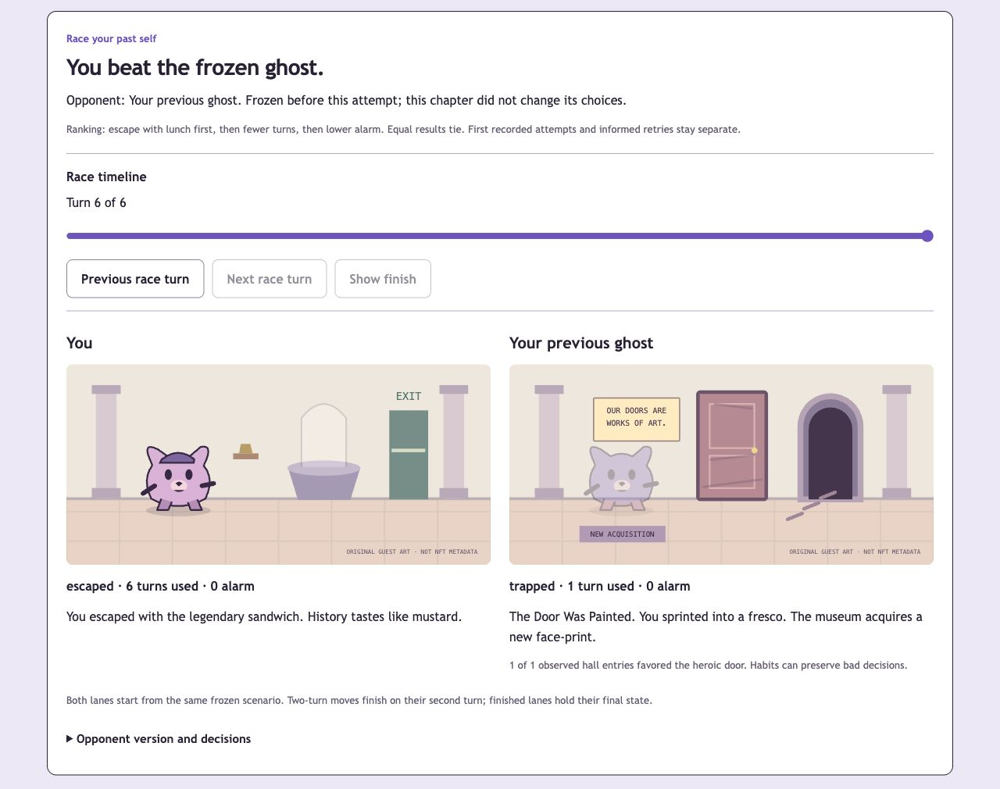

# Frozen guest races — October 10, 2026

The main app now supports racing a ghost chosen before an attempt, followed by a visual comparison on a shared turn clock. This continues the Doppelgänger + Museum of Bad Decisions direction, with one adventure and three rooms. Wallet development is paused at the user's request; existing authentication, ownership checks and official history remain in place. No new dependencies were installed.

## Implemented behavior

- A first guest chapter creates a habit ghost only after completion. **Race my new ghost** starts the same scenario against that existing version. A new guest adventure can use the latest completed guest ghost; unfinished chapters and official/private wallet history are excluded from opponent selection.
- The opponent's profile and version are copied into the new run before any action. Completing this run creates a separate next ghost version. Later training cannot change an in-progress opponent, an older result or a published exhibit.
- An active run reveals the opponent label/version, but no opponent profile, future decisions, scenario seed or replay. Completion reveals independent ghost frames, reasons and comparison. The player and ghost never share mutable resources.
- Museum challenges use the consented exhibit's ghost, derived from that single published chapter. Museum replay shows the exact recorded failure beside its independently evaluated strategy ghost. Private training IDs, other private chapters and guest/account identifiers are absent from public projections.
- The race clock advances by spent turns. The service vent stays in transit on its first turn and reaches extraction on its second. Finished lanes hold their last state. Native slider/previous/next/finish controls work without autoplay and can be used by keyboard. Exact recorded replay remains separate and now shows the original scene.
- Ranking retains the existing rule: goal escape, then fewer turns, then lower alarm; equal results tie. Observed first-attempt/informed-retry cohorts remain distinct. Other browsers and outside knowledge remain unverifiable; no person-count or anti-cheat claim is added.
- Withdrawal removes museum opponent revelation and comparison from already-started challenges. The private attempt can still finish. Public replay and new challenges remain unavailable. Previously downloaded public data cannot be recalled.
- Existing saves default to a null pre-attempt opponent. The app does not invent a race retroactively. Official starts retain null rivals in this guest-focused milestone. Original placeholder artwork remains in use; NFT artwork rights are still unconfirmed.

## Verification

Commands used bundled Node **24.19.0**, within this project:

```sh
npm run format:check
npm run lint
npm run typecheck
npm test
npm run build
PLAYWRIGHT_BROWSERS_PATH=/tmp/chog-playwright npm run test:e2e
```

Formatting, ESLint, strict typechecking and production build pass. **63 unit/integration tests pass across 12 suites**, with one opt-in live-RPC check skipped. **Seven production browser flows pass**. Build retains the previously documented optional Farcaster dependency and Tempo dynamic-import warnings from the existing wallet SDK; these are not new game regressions.

New behavioral checks cover:

1. Pre-attempt version selection, hidden future decisions, idempotent start, frozen version after later training, separate next version and identical retry scenario.
2. Unfinished-history and cross-actor isolation; museum projection contains only the consented chapter, including ghost frames, with no private training IDs.
3. Withdrawal during a challenge and legacy-record compatibility.
4. Two-turn timeline alignment, independent terminal lanes, invalid clock inputs and immutable replay frames.
5. Concurrent SVG paint-reference/label IDs and initial render boundaries. Multiple scenes use unique IDs so one replay cannot resolve another scene's pattern.
6. Real HTTP/UI guest rematch, reload persistence, keyboard slider, in-transit vent and terminal comparisons. The original cross-browser publication flow now also opens and scrubs the museum ghost replay.

Browser checks include reduced motion, 320px reflow with enlarged text and axe's WCAG A/AA tags on exercised states: zero reported violations. This is not a full accessibility certification. VoiceOver/NVDA announcements, native browser zoom, human usability and a real-holder gameplay session remain unverified.

The screenshot below comes from an agent-operated guest failure and rematch through the actual controls on an isolated local QA database, not fabricated results or human adoption. The normal local guest save was preserved. Tests use their separate SQLite database. No user wallet message was signed, NFT purchased/transferred, branch/commit/push created, deployment performed or paid service called.



## Desloppify evidence

Ran scan, status and next before and after changes. `.desloppify/` was already ignored. The scope stayed `/Users/apple/Desktop/chogsnft`; only dependencies, generated builds, test output and the local database directory were excluded. Authored source/tests remained scanned. No suppressions, fabricated assessments, wontfix decisions or score-driven fixture changes were used.

```sh
desloppify --lang typescript --exclude node_modules --exclude .next --exclude coverage --exclude test-results --exclude playwright-report --exclude data/local scan --path . --no-badge
desloppify status
desloppify next
```

| Score | Before | After |
| --- | ---: | ---: |
| Overall / lenient | 20.6 | 21.1 |
| Objective | 82.5 | 84.5 |
| Strict | 20.3 | 20.3 |
| Verified | 82.5 | 84.5 |

| Mechanical dimension | Before health / strict | After health / strict |
| --- | ---: | ---: |
| Code quality | 97.2 / 95.1 | 97.3 / 95.3 |
| Security | 100 / 98.0 | 100 / 98.0 |
| File health | 100 / 100 | 100 / 100 |
| Duplication | 100 / 100 | 100 / 100 |
| Test health | 44.9 / 43.4 | 50.6 / 42.7 |

All 20 subjective dimensions remain unassessed (shown as zero by the tool): abstraction fit, AI debt, API coherence, authorization consistency, contracts, convention consistency, architecture, dependency health, design coherence, errors, high/mid/low elegance, migration completeness, initialization coupling, logic clarity, naming, package organization, test strategy and type safety. No review ratings were imported.

The strict target is not reached. **76 open findings remain:** 20 subjective requests, 25 direct-import coverage warnings, 30 existing smells and the CLI-loaded Playwright configuration orphan. No new open security, structural, duplicate or smell finding remains. The test-health strict ratio decreased despite resolving import-linked coverage findings; both returned numbers are reported. Real browser coverage is not recognized as direct component imports by this detector. New server-render tests exercise simultaneous scene IDs and initial revelation boundaries, alongside the actual interactive browser flow. The scanner still tries the removed `next lint`; direct ESLint passes. One formatter attempt overlapped the scanner's temporary tsconfig and failed; the subsequent completed-scan formatter check passes.

## Next gate

Gather consenting human feedback on the three-room choices and the ghost explanation, then tune content without breaking frozen versions. Complete the subjective quality review and remaining presentation/submission walkthrough. Advanced rankings, more missions and animations remain optional. Official pre-attempt races, artwork rights, real-holder evidence, event deadline confirmation and authorized public hosting remain separate pending work.
