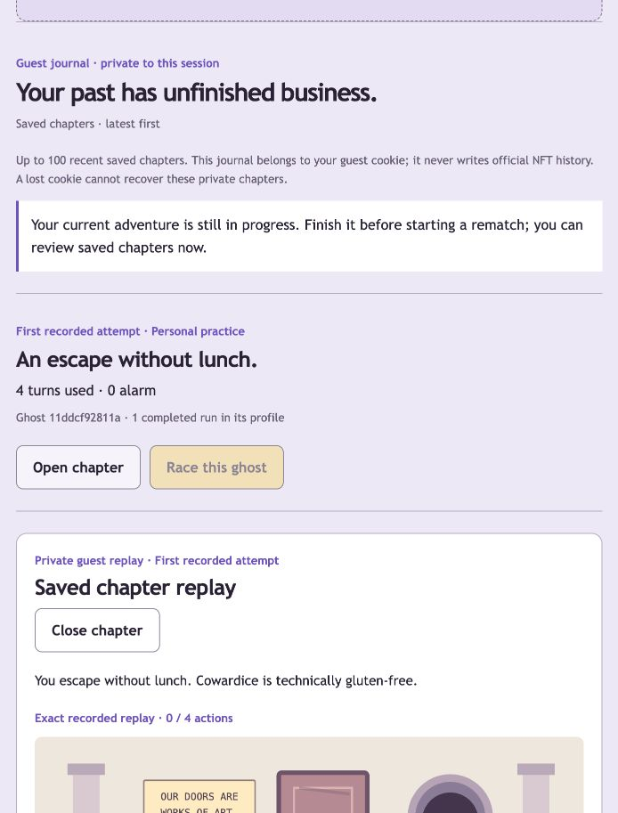

# Guest journal and rematch hub — October 10, 2026

The main app now provides a private guest chapter journal, saved replay reader, selected-version ghost races and a museum rematch log. This continues Phase 4 with the same sandwich adventure, three rooms and deterministic habit policy. Wallet development remains paused; official ownership/authentication and public token history are preserved. No new dependencies were installed.

## Behavior and boundaries

- **My journal** lists completed guest chapters, latest first, with outcome, turns, alarm, observed exposure cohort and frozen ghost version/support count. It is a projection of the latest 100 stored records for that guest session; unfinished records occupy that window but are omitted from the journal. There are no invented dates or permanent chapter ordinals. This is not a public leaderboard or a count of people.
- **Open chapter** requests the completed run through its guest cookie. A separate replay panel receives focus; closing restores focus to the originating button. The active adventure stays intact. A failed read provides a nearby retry control.
- **Race this ghost** selects that chapter's own completed ghost version, even when a more recent version exists. It copies the selected profile into a new private guest run on the source scenario, records `ghostOf`, and labels the opponent **Your selected past ghost**. Before completion, future decisions/profile remain hidden. The new race always belongs to the informed-retry cohort. Finishing derives a separate next ghost version.
- Selecting a chapter that was originally a museum attempt creates **personal practice**, with no exhibit comparison. **Rematch challenge** instead retains the frozen exhibit scenario/opponent and challenge attribution. These are distinct operations.
- New personal ghost races are rejected while the latest guest adventure is unfinished. The journal also disables rematch controls in that state; replay reading stays available. Existing adventure start/share-link behavior is preserved.
- Race requests use a persistent UUID for idempotence. Retrying a lost response retrieves the same race, rather than creating another version or consuming actions. Source chapter, actor, guest mode, completion and frozen-profile availability are validated on the server. Chosen-ID collisions fail and roll back.
- Challenge progress groups only this session's saved attempts by exhibit **and** exposure cohort. Each group shows first shown, best shown and improvement within that cohort. Goal escape outranks failure, then fewer turns, then lower alarm; equal scores retain the earlier best shown. First shown is within the bounded journal window, not a claim to complete lifetime history.
- A withdrawn exhibit becomes **Withdrawn exhibit**; its title, public opponent, comparison and rematch control are withheld. Personal saved attempt outcomes remain readable. A former challenger can still race their own private chapter ghost, without restoring the withdrawn public exhibit. Previously downloaded public data cannot be recalled.
- Official chapters and unfinished drafts are absent from guest journal summaries and unavailable through its replay/race endpoints, even in tests using the official actor's ID. Summary DTOs omit scenario, actions, private training IDs, actor IDs, ownership records and profile contents. Authorized completed replay intentionally reveals its own scenario/actions/profile; it does not reveal another session's records.
- Private responses use `Cache-Control: no-store`. Guest cookies retain the existing HTTP-only, SameSite Strict scope and seven-day lifetime. Cookie loss cannot recover a private journal. Official NFT history remains separate; no NFT metadata or artwork is used for these new views.
- Guest mutations and their journal projection now share one outer SQLite transaction, with existing nested savepoints. A projection-validation failure rolls back the accompanying action/publication. A genuinely lost HTTP response after commit remains safely retryable.

## Implementation

`domain/journal.ts` defines the guest DTOs and pure cohort progress grouping. `server/journal.ts` owns private completed-chapter reads and selected races; it delegates validated replay to `RunService`. `RunRecord.ghostOf` defaults to null for legacy records, without inventing a past selection. `/api/game?chapter=<uuid>` is a cookie-scoped read; `operation: race` accepts only the new request ID and source chapter ID. Regular guest responses carry the journal projection.

Guest UI and hooks are grouped in `components/guest/`. Active gameplay orchestration, private journal reading and public exhibit replay reading are separate. They share one request gate through callbacks owned by the active hook, preserving request serialization and mounted-state checks. Shared replay/illustration components remain outside that guest folder. Wallet hooks were not refactored.

## Tested evidence

Using bundled Node **24.19.0** in this project:

```sh
npm run format:check
npm run lint
npm run typecheck
npm test
npm run build
PLAYWRIGHT_BROWSERS_PATH=/tmp/chog-playwright npm run test:e2e
```

All checks pass. **77 unit/integration tests across 15 suites**, with one opt-in live-RPC check skipped. **Nine production browser flows pass**. The build retains the existing wallet SDK warnings for an unused optional Farcaster module and Tempo dynamic import, documented in PRIVY.md. No new dependency/advisory change was made.

New checks exercise:

1. Completed-only summaries, latest-first ordering, bounded history, private-ID/profile omission, cross-session rejection and official-mode exclusion.
2. Older selected ghost versus a newer available version, identical scenario, hidden future decisions, idempotence, restart persistence, chosen-ID collisions, missing profiles, unfinished-current-run rejection and legacy records.
3. Separate challenge cohorts, goal/turn/alarm ranking, tie stability, private input immutability and withdrawal behavior.
4. Actual HTTP cookie/origin/schema/no-store boundaries and rollback after a corrupted older record makes the journal projection invalid.
5. Real UI reopen/close focus, replay scrubbing, selected race with a deliberately lost committed response, reload, unrelated browser isolation, disabled races during active play, museum rematches and nearby failed-read recovery.
6. 320px reflow with enlarged text, reduced motion and axe's WCAG A/AA tags in exercised journal/review states: zero reported violations. Native browser zoom and live VoiceOver/NVDA behavior remain unverified; this is not a full accessibility certification.

The screenshot below is the actual local guest journal and an earlier agent-operated chapter, not fabricated results or human feedback. Visual QA reopened that chapter without playing or replacing the normal active save. It remained Room 2, nine turns, zero alarm and one decoy. The replay panel was then closed, returning focus to Open chapter. Browser tests use the separate test database. No user wallet signature, NFT transaction, branch, commit, push, deployment or paid service was performed.



## Desloppify

Before and after: same project boundary, scan/status/next, existing ignored `.desloppify/`, unchanged dependency/build/test/database exclusions. Authored engine, server, UI, content and tests stayed scanned. No suppressions, wontfix decisions or subjective ratings were added.

```sh
desloppify --lang typescript --exclude node_modules --exclude .next --exclude coverage --exclude test-results --exclude playwright-report --exclude data/local scan --path . --no-badge
desloppify status
desloppify next
```

| Score | Before | Final |
| --- | ---: | ---: |
| Overall / lenient | 21.1 | 21.6 |
| Objective | 84.5 | 86.6 |
| Strict | 20.3 | 20.8 |
| Verified | 84.5 | 86.6 |

| Mechanical dimension | Before health / strict | Final health / strict |
| --- | ---: | ---: |
| Code quality | 97.3 / 95.3 | 97.6 / 95.5 |
| Security | 100 / 98.0 | 100 / 98.3 |
| File health | 100 / 100 | 100 / 100 |
| Duplication | 100 / 100 | 100 / 100 |
| Test health | 50.6 / 42.7 | 54.5 / 45.1 |

The intermediate scan exposed a large guest hook, directory overload and repeated state boilerplate. Splitting the read responsibilities and grouping guest modules resolved those findings. A new test helper originally named `failure` created a cross-file signature warning; it now describes its behavior as `completeDoorFailure`. The confirming scan reported no signature variance, but the older finding persisted in state; it was explicitly resolved as fixed with this evidence and then rescanned. No existing HTTP helper was renamed or excluded.

**78 open findings remain:** 20 unassessed subjective dimensions, 27 coverage warnings, 30 pre-existing smells and the Playwright-config orphan. The two extra coverage warnings identify the new private/public reader hooks; interactive browser tests exercise their behavior, but direct isolated hook branch tests remain a coverage gap. Existing guest-hook complexity/nested-closure findings remain visible. No new open security, structural, duplication, signature or smell finding remains. The strict target is not reached.

All subjective dimensions remain unassessed, shown as zero: abstraction fit, AI debt, API coherence, authorization consistency, contracts, conventions, architecture, dependency health, design coherence, errors, high/mid/low elegance, migration completeness, initialization coupling, logic clarity, naming, package organization, test strategy and type safety. `next` still requests subjective review. No review scores were imported. The scanner still calls removed `next lint`; direct ESLint passes. A formatter attempt overlapped the scanner's temporary tsconfig; the final check after scanning passes.

## Next gate

Gather consenting human play feedback on chapter discovery, the three-room choices and the difference between exact replay, selected ghost race and museum rematch. Tune confusing copy/content while retaining frozen versions. Complete the quality review and final walkthrough before authorized hosting/submission. Leaderboards, extra missions and animations remain optional; wallet work stays parked. Real-holder gameplay, artwork permission, exact event cutoff and deployment remain separate unverified gates.
