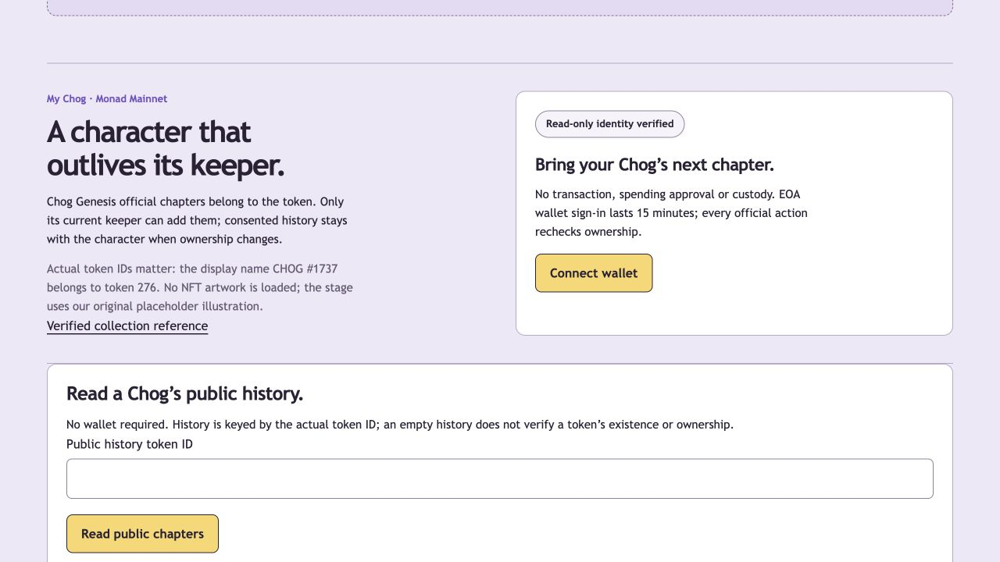

# Current Soryn competitor policy — October 16, 2026

[The M7 release report](M7_RELEASE_REPORT.md) and [series policy](SERIES.md) supersede the historical UI/count/status notes below. The actual token ID, allowlisted chain/collection and SIWE statement remain unchanged. Privy is the sign-in path. Selected-token official play uses fresh server authority; no wallet is needed for labelled guest play.

Combat results are private by default, stored with source/rules/participating generation. Per-result consent publishes only a bounded projection with the keeper's historical alias. A successor inherits published results, not private Story runs, drafts or sessions. Owner lookup failures show unavailable. Soryn records remain off-chain. No real-holder Privy session is claimed by the fixture gates. Artwork licensing remains separate from metadata and identity.

---

# Real Chog identity milestone

Latest authentication update: [PRIVY.md](PRIVY.md) replaces injected-only connection with Privy login and verified provider tokens. Counts and original UI paths below are historical identity milestone evidence; no actual Privy hosted login has been observed yet.

Local identity slice implemented and verified within the scope below, October 10, 2026. Authoritative identity is Monad Mainnet (143), Chog Genesis contract `0xc96d31f8626c6d03fae5dcd3d61e3fb9f4a73763`, actual uint256 token ID. Display names and metadata filenames never determine the token ID.

## Verification

Read Chog's verified [X profile](https://x.com/ChogNFT), which displays `linktr.ee/chognft`; [Linktree](https://linktr.ee/chognft) links to [Chog Genesis](https://opensea.io/collection/chog-genesis). Read the [item page](https://opensea.io/item/monad/0xc96d31f8626c6d03fae5dcd3d61e3fb9f4a73763/276): CHOG #1737, ERC721, MONAD, TOKEN #276. The [official network documentation](https://docs.monad.xyz/developer-essentials/network-information) specifies chain 143 and public RPC endpoints.

Independent read-only checks on rpc.monad.xyz returned chain 0x8f, 17,264-byte bytecode, ERC165 and ERC721 support true, invalid interface false, ownerOf(276), name Chog Genesis and a token URI ending in 1737.json. Raw evidence will be retained in docs/evidence. rpc2.monad.xyz returned HTTP 403. No transaction or purchase was performed.

## Implementation policy

- EOA wallets initially: user clicks Connect and explicitly requests a sign-in message. No automatic signatures, approvals or transactions. Deployed contract wallets fail with an honest unsupported message.
- Server-issued exact SIWE message binds domain/scheme, URI, chain, wallet, nonce, expiry, token and ownership generation. Browser-bound nonce is single-use; durable session secret is hashed in SQLite, HTTP-only, SameSite Strict, 15-minute expiry. Challenge expires in five minutes.
- Every official mutation requires a new RPC observation: correct chain, allowlisted bytecode/interface, fresh finalized and latest owners agree, and canonical checkpoint continuity plus token-specific Transfer logs. Any transfer, including away/back or self-transfer, or uncertain continuity rotates the generation and revokes old grants. Pending transfers fail closed. Public RPC is trusted evidence, not a cryptographic ownership proof.
- Checkpoints and grants persist across restarts. Bounded log queries and observation timeouts fail closed; an expired continuity window requires reauthentication, not recovery of an old grant. Off-chain writes cannot be perfectly atomic with subsequent blockchain transfers; record the checked block and disclose that race.
- Engine/rules unchanged. Official runs have token identity and generation; no guest endpoint can access them. Private runs and training references stay with their author and ownership generation. Only explicit publication creates public token chapters; snapshots contain consented actions and a ghost derived from those actions alone. Published history follows the token, preserving aliases, never wallet/session IDs or private drafts.
- Identity-only character seed until stable traits and artwork rights are separately confirmed. The founder asked to continue; no art license was supplied. Existing original geometric illustration remains a placeholder, never described as Chog NFT art.

## Required verification scope (executed below)

Non-owner, bad/wrong/expired/replayed signatures, origin/cookie isolation, transfer-away/back, reorg, RPC outages/stale blocks/malformed logs, idempotency, frozen ghost versions, inherited public chapters without private drafts, browser wallet rejection/account changes, guest regression, static checks/build and post-change Desloppify scan.

## Completed local implementation and test evidence

The scope above is implemented. The placeholder stays original; rights were not provided. Public metadata traits are not fetched, and the only character initialization uses chain/collection/actual token ID. Live bytecode and ERC-721 reads justify the allowlist; raw results are in [collection-rpc-verification.json](evidence/collection-rpc-verification.json). The implemented adapter itself passed two live observations in [identity-adapter-live.json](evidence/identity-adapter-live.json). Neither probe signed a message or sent a blockchain transaction. OpenSea's item details and the live token URI confirm the naming mismatch; `1737.json` is metadata, not token identity.

The server issues exact SIWE messages and verifies real EOA cryptographic signatures. Non-owners may authenticate for their own consent controls, but receive no owner grant and cannot begin, advance or publish an official chapter. Current owners can play the existing authoritative adventure, create private completed runs/ghosts, and explicitly publish a chapter; failed chapters may also become museum challenges. Title/alias/consent fields are bounded and validated. Later completions create new private ghost snapshots; public chapter ghosts use consented actions alone, remain versioned/frozen and follow the token. Scenario, actions, profile and identity determine their SHA-256 version. No private training references appear in public chapters or museum replay views.

New keepers see public history, with original aliases, while old-generation private runs cannot be continued. Authentication cookies, checkpoints, generations, public snapshots and private runs survive database reopen. Guest mode is preserved and cannot access official records, even with a chosen actor/run ID. Legacy guest rows without new identity fields remain valid. Public chapter lookup needs no wallet and explicitly does not prove token existence. Published chapters known to this installation and known prior guest play mark subsequent observed attempts as informed retries; fresh wallets/cookies are not proof of novel human knowledge.

Consent revocation is a privacy control rather than new token authorship: an authenticated original contributor can withdraw only their own public records after transfer. Fresh RPC evidence is still required, but current ownership is not required for this removal. A successor cannot edit/withdraw the previous contributor's records or attribution. Withdrawal removes public access and new challenge starts; previously delivered/downloaded public data cannot be recalled, and withdrawn rows/backups are retained. Existing private challenges can finish as in the guest slice. This consent policy is separate from owner-only new official chapters.

### Commands and actual results

All Node commands used Node 24.19.0. Production build uses Next.js 16.4.0, React 19.3.0, viem 2.57.4 and Node's SQLite driver.

| Check | Result |
| --- | --- |
| `npm run format:check` | All checked source/test/config files formatted |
| `npm run lint` | Direct ESLint passes without warnings |
| `npm run typecheck` | Strict TypeScript passes |
| `npm test` | 42 pass across seven suites; one opt-in live test skipped by default |
| `MONAD_LIVE_READ=1 npm test -- tests/integration/rpc.test.ts` | All eight adapter tests pass, including the live read-only test; two live observations saved |
| `npm run build` | Production build passes; `/api/game` and `/api/identity` are dynamic Node routes |
| `npm run test:e2e` | Seven production browser flows pass; detailed [results](evidence/identity-browser-results.txt) |
| `npm audit --omit=dev` | Zero vulnerabilities in production dependencies; [report](evidence/identity-production-audit.json) |

Signature tests use newly generated disposable EOA keys, actual SIWE formatting and actual signature recovery. Ownership transition/failure tests use explicitly synthetic chain observations. Browser tests exercise the real local production API, game rules, signature verification and SQLite against an isolated synthetic HTTPS RPC on loopback 3200 and a separate database on port 3100. The fixture serves verified public bytecode but disposable owners; all transaction/approval RPC methods are forbidden. The OpenSSL harness trusts only its temporary certificate through `NODE_EXTRA_CA_CERTS`, keeps TLS verification enabled and removes TLS material at exit. No user keys, extensions or accounts are used. No fixture fallback exists in the real app, whose default RPC is rpc.monad.xyz.

Executed boundaries include wrong chain/collection/display token IDs, non-owner authorization, altered domain/wallet/chain/nonce, incorrect signatures, browser mismatch, expired challenges/sessions and consumed nonce replay; transfer during signing, transfer away/back, revoked generations, reorg/backward/long-gap continuity, pending transfers, stale blocks, changed code/interface, malformed/removed/out-of-range logs and unavailable RPC. Tests also cover request origin/body bounds, guest isolation, idempotent retries, transactional rollback, persistent reopen, legacy guest compatibility, corrupted stored permissions and public/private projection. Browser coverage includes native publication consent, inherited history without drafts, frozen versions after transfer, RPC outage/retry, author-only withdrawal, wallet signature rejection/account changes, public lookup, keyboard/mobile/reduced-motion/enlarged-text guest flows, and axe WCAG A/AA checks on the tested screens.

Initial tests exposed and fixed non-decimal BigInt validation and reliance on JSON property order when comparing ownership observations. Integration rollback checks require chapter and museum publication to commit atomically. Browser verification caught a withdrawal test racing the server response; it now waits for the confirmation before refreshing the successor. Source review split wallet presentation/session lifecycle from game controls, shared request schemas and gave corrupted persisted data an explicit unavailable response.

### Remaining gate and practical limits

- No consenting real holder has yet completed a wallet sign-in or official gameplay session in this build. Live evidence proves contract/read adapter behavior; synthetic tests prove the exercised code behavior, not an actual NFT succession transaction. The next human check is holder-operated sign-in and play, with their own wallet confirmation. No signing authority was delegated to the agent.
- Art licensing and stable trait verification remain open. The founder directed continuation without supplying a license; no NFT art or trait-based characterization is used.
- EOA injected wallets only. Deployed/delegated contract wallets and WalletConnect are unsupported and do not silently fall back to guest ownership. Use a browser with a compatible wallet extension; the in-app browser may have none.
- RPC evidence is a trusted provider snapshot. A transfer after the final read may race the off-chain commit; there is no consensus claim or continuously indexed transfer listener. Rate limits/long inactive gaps may require a fresh sign-in. No perfect anti-cheat or prior-knowledge detection is claimed.
- A public RPC endpoint other than rpc.monad.xyz returned 403 during verification. No paid provider or budget was selected.
- Existing development-tool audit advisories involve the ESLint config's glob/braces dependency chain (five high advisories). The suggested forced fix downgrades Next's lint tooling to a different major generation; it was not blindly applied. Runtime dependency audit is clear. No claim of a completed repository-wide health campaign is made.
- Original event receipt, exact submission cutoff, human usability/retention evidence and deployment remain pending. The directory still has no Git repository; no purchase, transfer, deployment, commit or push was performed.

## Desloppify final evidence

Pre-implementation scan/status/next ran in this project: overall 19.8, objective 79.3, strict 19.6, verified 79.3. After implementation and fixes, the same boundary was rescanned; status and next were reviewed. Authored game/API/UI/tests remain in scope; only existing obvious dependency/build/cache/test-output/local-database exclusions were used. No ratings, suppressions, exclusions or wontfix decisions were fabricated to improve results. No subagents, branches, commits or pushes were used.

| Overall | Objective | Strict | Verified |
| --- | --- | --- | --- |
| 20.4 | 81.7 | 20.2 | 81.7 |

| Dimension | Health | Strict |
| --- | --- | --- |
| Code quality | 97.3 | 95.3 |
| Security | 100.0 | 97.7 |
| File health | 100.0 | 100.0 |
| Duplication | 100.0 | 100.0 |
| Test health | 44.7 | 44.7 |
| Abstraction fit | 0.0 | 0.0 |
| AI generated debt | 0.0 | 0.0 |
| API coherence | 0.0 | 0.0 |
| Auth consistency | 0.0 | 0.0 |
| Contracts | 0.0 | 0.0 |
| Convention drift | 0.0 | 0.0 |
| Cross-module arch | 0.0 | 0.0 |
| Dep health | 0.0 | 0.0 |
| Design coherence | 0.0 | 0.0 |
| Error consistency | 0.0 | 0.0 |
| High elegance | 0.0 | 0.0 |
| Stale migration | 0.0 | 0.0 |
| Init coupling | 0.0 | 0.0 |
| Logic clarity | 0.0 | 0.0 |
| Low elegance | 0.0 | 0.0 |
| Mid elegance | 0.0 | 0.0 |
| Naming quality | 0.0 | 0.0 |
| Structure nav | 0.0 | 0.0 |
| Test strategy | 0.0 | 0.0 |
| Type safety | 0.0 | 0.0 |

All 20 subjective dimensions above remain unassessed; their zeros are not completed quality ratings. The next queue item is the initial subjective review. There are 67 open findings, including 20 review requests, 22 direct-import coverage warnings, 24 smell findings and the CLI-loaded Playwright config orphan warning. Current scans have no open security or duplication findings. Coverage warnings include browser-exercised UI and indirectly exercised boundaries; passing flows do not establish every isolated branch is tested. Remaining smells include hook closure/complexity findings, explicit reference/config URLs and numerical constants, fixture/test assertions and pre-existing SVG color literals. These remain documented rather than suppressed or cosmetically rewritten. The removed Next `next lint` command still reduces that scanner detector; direct ESLint passes. The target of 85 strict has not been reached.

Raw [scan](evidence/identity-desloppify-scan.txt), [status](evidence/identity-desloppify-status.txt) and [next](evidence/identity-desloppify-next.txt) are retained. This is a tested identity milestone, not a completed repository-wide health campaign.

## Local preview

The real app is running at http://127.0.0.1:3000/#character using the existing local database and the public Monad RPC, with no synthetic ownership fallback. The screenshot shows signed-out connection/public-history controls, not a claimed holder session. The existing guest run was read without gameplay changes.

## Current access threshold — October 18, 2026

The current qualification is at least 500 $CHOG OR a verified Chog NFT, independently. The single numeric threshold and verified decimals live in `src/domain/chain/chogToken.ts`; UI copy and read-only server balance comparisons derive from it. No dollar equivalent or spending transaction is involved.

New grants use `soryn-access/2`. Persisted `soryn-access/1` grants remain parseable as frozen encounter evidence, but cannot satisfy the entitlement read cache: refresh and every new Story/queue/room admission recheck current qualification. Existing started encounters and series retain their original grants. No progress, earned title or completed record is migrated/deleted. Selected NFT competitors retain their independent fresh ownership and generation/no-contest policy.

My Chog now separates private player eligibility/history from selected NFT competitor controls. The public search is `/explore`; existing `/chog/<tokenId>` URLs and consent rules remain unchanged. Holder presentation is opt-in and private; holder status or balances are not published by this dashboard.

### Wallet-play session recovery

Wallet connection through Privy and an authenticated Soryn session are separate states. The bridge reads the SDK's subscribed identity token (`useIdentityToken`) and lets its access-token lifecycle run normally. It does not force a `/users/me` refresh for each application request. Server-side JWT, linked-wallet, selected-wallet, nonce, signature, expiry and exact-origin validation remain required.

Before requesting a Soryn message signature, the client checks `/api/access?records=1` for an existing session. A successful verification is followed by the same cookie-backed readback before eligibility is loaded. An uncertain verification acknowledgement causes one session read, never a verification replay. If the response and Set-Cookie were both lost, the client cannot claim authentication from the connected wallet alone. An explicitly expired session permits a new sign-in; a holdings failure or paused admission gate preserves confirmed authentication and private-record access.

Mutations are serialized, disabled while pending and cancelled on principal-view teardown. Signature and completion phases are explicit. Application 429 responses include a Retry-After value based on the existing fixed window; the client respects it with a countdown and requires a manual retry. Challenge/verification budgets are keyed by a hash of the verified Privy identity rather than one global challenge key or client-supplied forwarding headers. No on-chain transaction or token approval is requested by this flow; the application uses `personal_sign`.
