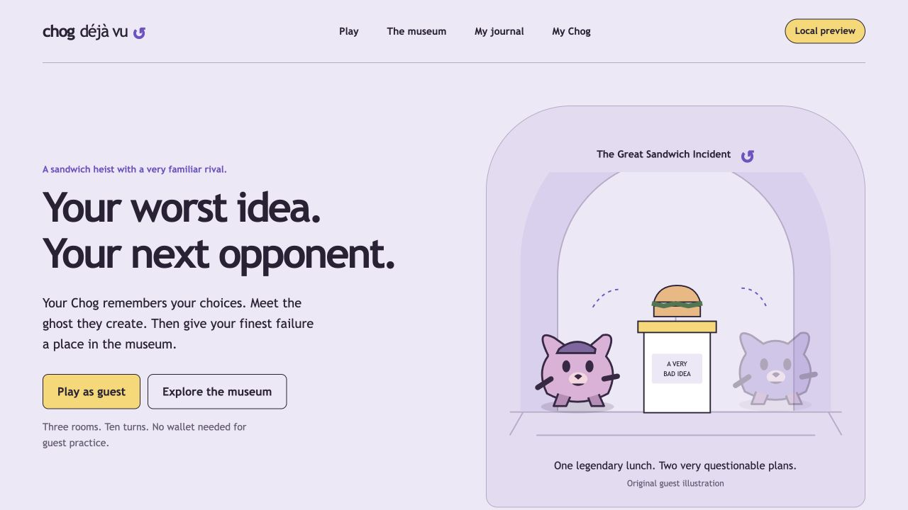

# Landing page and dedicated app pages

**Current identity — October 14, 2026:** [the complete game rebrand](REBRAND.md) and [shared design system](GAME_IDENTITY.md) supersede earlier palette, typography, hero copy and decoration described here. Approved rendered artwork and existing functionality remain preserved.

**Current direction:** the [arena-only refinement](ARENA_ONLY_LANDING.md) supersedes the character/portal hero and arrow controls described below. The previous milestone and its evidence remain historical.

Implemented October 10, 2026. Wallet development remains paused. Existing authentication and authority checks are preserved.

## Design direction

Read the published UI Skills frontend-design, better-ui and better-accessibility guidance again before this pass. Sources: https://www.ui-skills.com/skills/anthropics/frontend-design, https://www.ui-skills.com/skills/jakubkrehel/better-ui, https://www.ui-skills.com/skills/jakubkrehel/better-accessibility. No global skill installation, UI framework or new dependency.

Keep the established ink #292137, gallery lilac #ede8f8, paper #ffffff, admission yellow #f7db65, ghost violet #6a4bc6 and muted ink #655c75. Trebuchet MS remains the local rounded display/body face. Make the original guest and ghost considering a sandwich the central visual, with a museum arch and plinth. The visual is an original SVG composition using the existing original mascot; no NFT artwork or metadata images are reused.

The landing page pairs a comic headline and two direct entries with that illustration. The next section describes the actual play → ghost → publication sequence. A separate keeper invitation explains token-bound chapters, and native disclosures explain guest access, replay versus strategy ghost, and publication consent. No fabricated exhibits, counters, testimonials or urgency. Desktop uses a two-column hero; mobile keeps headline, action, then illustration in reading order. No autoplay or unsolicited animation.

## Routes and state

| URL | Purpose |
| --- | --- |
| `/` | Landing page: explain the loop and enter guest play or museum |
| `/play` | Active guest adventure, completed result, replay, ghost race and publication controls |
| `/museum` | Actual consented exhibits, public replay and challenge entry |
| `/journal` | Private completed guest chapters, selected historical ghosts and cohort-separated museum rematches |
| `/character` | Existing My Chog identity, public token history and Privy sign-in |
| `/play?challenge=<exhibit UUID>` | Guest attempt on the published frozen scenario |

These are real App Router pages with page-specific titles and active navigation. One shared game layout owns the guest hook/context, preserving the current run, pending mutation and private/public readers through app-page navigation. Only the selected page renders. The character page alone imports the Privy identity section. Visiting the landing page does not establish a guest cookie, request game/identity APIs or initialize wallet login. Its main content and links are server-rendered and readable without JavaScript. Gameplay requires JavaScript as before.

Mutations retain the existing server contracts and idempotency. Starting a race/challenge from Journal or Museum navigates to Play only after success. Failed saved requests remain retryable from other app pages. Opening a challenge URL waits for session recovery and uses the same start contract; refreshing an already-current challenge keeps its run ID. New share links use `/play?challenge=…`; existing `/?challenge=…` links redirect server-side. Old `/#adventure`, `/#museum`, `/#journal` and `/#character` bookmarks map to the relevant page after client hydration. Unknown landing anchors do not redirect.

Navigating home leaves the guest layout; returning recovers the durable latest run and journal through the HTTP-only cookie. Transient replay scrub positions and form edits are not persisted to the database. Museum/journal read state lives in the shared layout, but replay components can remount on navigation. No draft, history or database migration was needed. The normal local database was preserved.

## Verification

Commands use Node 24.19.0 and the existing isolated browser/RPC fixture. Formatting, ESLint, strict TypeScript and the production build pass. All **77 unit/integration tests across 15 suites pass**, with one opt-in live RPC test skipped. All **13 production browser flows pass** in the final run (29.5 seconds).

Browser coverage includes landing keyboard entry and native disclosures, no automatic guest/wallet bootstrap, no-JavaScript landing content, dedicated-view isolation, active navigation/title/focus, active-run preservation across app navigation/back/refresh/home, legacy bookmarks/challenges, invalid challenge recovery and saved-request retry from another page. Existing gameplay/replay/consent/withdrawal, ghost race, journal privacy/cohorts and protected identity behavior remain in the regression suite.

Axe checks the landing and exercised app states with WCAG A/AA tags. Reflow at 320px, enlarged text, reduced motion and keyboard activation are automated. Live VoiceOver/NVDA behavior and human usability feedback remain unverified. Read-only native-browser inspection confirmed that the normal local Play and Journal pages recover the existing saved chapters. No gameplay action, publication or signature was performed in that inspection.

Commands: `npm run format:check`, `npm run lint`, `npm run typecheck`, `npm test`, `npm run build`, and `PLAYWRIGHT_BROWSERS_PATH=/tmp/chog-playwright npm run test:e2e`. The known optional Farcaster Solana module and viem/Ox Tempo bundler warnings remain; the build succeeds. No new dependency, wallet configuration or authentication implementation was added.

| Severity | Location | Before | After | Why |
| --- | --- | --- | --- | --- |
| MEDIUM | components/site/AppShell.tsx | Section hashes on a long single screen | Real routes, current-page text cue/underline, titles and focus to the page heading on app navigation | Users can identify the new view and bypass repeated navigation; checked keyboard/focus behavior (2.4.1, 2.4.3) |
| MEDIUM | components/guest/Journal.tsx | Closing a replay used a DOM reference lost when leaving the page | Stable chapter-button IDs restore focus even after leaving and reopening Journal | Keeps keyboard position after the private reader remounts; browser regression added (2.4.3) |
| LOW | components/site/Landing.tsx, app/landing.css | No introductory destination | Subject-specific hero, clearly labelled guest entry and native disclosures | Gives a new visitor one understandable starting point; desktop/mobile screenshots reviewed |
| LOW | components/guest/MuseumScreen.tsx, JournalScreen.tsx | Empty initial arrays could resemble loaded empty content | Explicit loading messages before the initial read completes | Honest loading state; recommendation, not a claimed WCAG failure |

Scoped UI/accessibility review: **Approve** for the exercised states; zero axe A/AA violations there. Not a full accessibility certification. VoiceOver/NVDA, native browser zoom and consenting human usability feedback are **Not verified**.

## Desloppify

Ran the project-scoped scan/status/next before implementation and after the final changes. `.desloppify/` is ignored. The final scan explicitly excludes dependencies, build/cache/worktree output, browser artifacts and local database output. An intermediate scan caught a generated Playwright trace stylesheet during the browser run; explicit generated-output exclusions removed it. Authored source, engine, content and tests are included. No suppressions, unjustified resolutions, wontfix decisions or subjective ratings were used.

| Score | Before | Final |
| --- | ---: | ---: |
| Overall | 21.7 | 21.6 |
| Objective | 86.6 | 86.3 |
| Strict | 20.8 | 20.8 |
| Verified | 86.6 | 86.3 |

Final mechanical health/strict: code quality 97.5/95.6, security 100/98.7, file health 100/100, duplication 100/100, test health 47.9/37.9. The target is not reached. `next` still asks for an initial subjective review; all 20 dimensions remain unassessed.

**96 open findings remain**, compared with 78 before: 20 subjective requests, 40 import-linked test warnings (27 before), 32 smells (30 before), three single-use composition suggestions and the existing Playwright configuration orphan warning. The new browser suite exercises the routed surfaces, but the scanner does not count HTTP/browser traversal as direct test imports. Isolated hook-branch coverage remains incomplete; these warnings were not hidden or satisfied with shallow mirror tests.

The landing-size finding was resolved by separating its four cohesive sections. The two new async-without-await warnings refer to root and Play page functions; both actually await Next's promised `searchParams`, visible in source and verified by the build/legacy-query tests. They remain recorded as parser limitations rather than suppressed. The three single-use suggestions are AppShell and the Play/Museum client adapters: they provide the persistent layout and server-metadata/client-hook boundaries, and were retained for those responsibilities. No new open security or duplication finding remains. The scanner still tries removed `next lint`; direct ESLint passes independently.

No branch, commit, push, deployment, NFT purchase/transfer or wallet signature was performed. The local server is available on loopback; no public deployment or real-holder gameplay is claimed.

## Next gate

Gather consenting human feedback on landing → play → ghost → museum → journal, then fix observed confusion and prepare the final walkthrough. This pass does not add missions, a leaderboard, artwork permissions, deployment or holder-login evidence. Wallet work remains paused.

## Cinematic landing — October 14, 2026

The previous landing design is superseded by the approved rendered-fighter gateway, interactive twelve-fighter catalogue, silent presentation-only specials and four cosmetic arena selections. Existing secondary routes, challenge redirects, wallet/ownership authority and private records remain preserved. Incoming arena suggestions select setup without creating or replacing a battle. See [the current implementation/evidence report](CINEMATIC_LANDING.md). Earlier results above are historical; the latest pass has 218 app tests, 13 focused browser flows, format/lint/type/build and a scoped Desloppify rescan.
