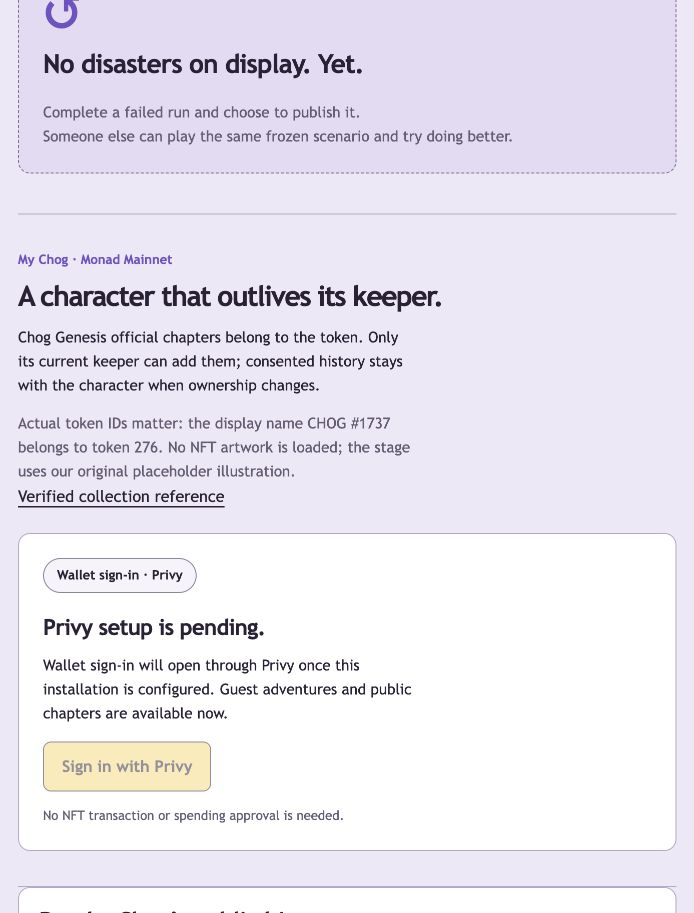
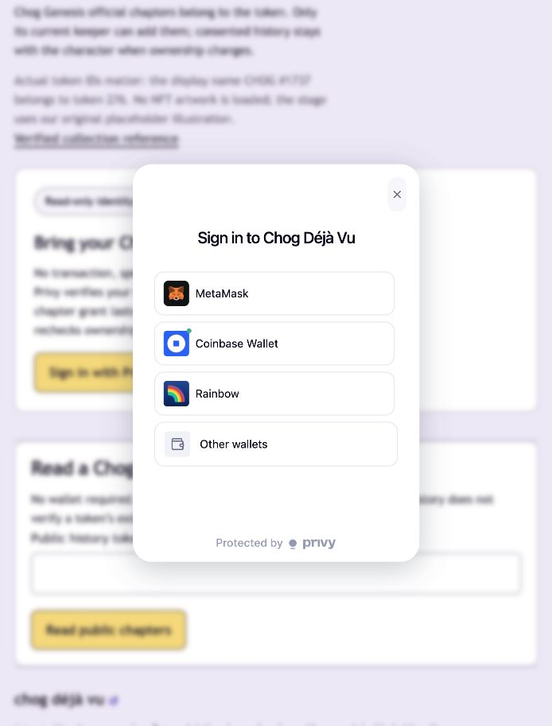

# Privy wallet sign-in integration

Current combat-first extension: the existing verified-provider/local-grant flow now authorizes private official arena battles with fresh ownership/generation checks on every start/round. My Chog opens combat directly after the grant; adventure chapters and publication remain secondary. See COMBAT.md for current 165-test/29-browser evidence and real-holder manual steps. No real holder gameplay is implied by automated fixtures.

Live wallet selector activated and observed, October 10, 2026. User-operated wallet login and token-chapter signing remain pending. The requested auth provider is Privy. Preserve Monad 143, actual token IDs, fresh owner checks, private/public isolation and frozen history. Guest gameplay must work without configured Privy credentials.

## Design and setup

Use the official React SDK with wallet-only login, Ethereum wallets and Monad as the supported/default chain. Automatic embedded-wallet creation is disabled. Privy performs wallet login; a separate explicit local SIWE message grants chapter access for a token/ownership generation. No automatic signing, transaction, spending approval, financial UI or agent-held credential is introduced.

Verify both Privy access and identity JWTs on the server with ES256, the app’s official published signing-key set (or an explicitly pinned public PEM key), issuer privy.io, configured app-ID audience and mandatory issue/expiry/subject claims. Their subjects must match and the chosen wallet must appear in the signed identity token's Ethereum wallet accounts. The local browser-bound nonce and chapter cookie also bind that Privy subject. Every protected request revalidates provider tokens and checks the cookie wallet/subject; official mutations continue to read current ownership and transfer continuity. Privy authentication is not NFT ownership authority.

The public App ID was requested. To activate live login, configure:

- `NEXT_PUBLIC_PRIVY_APP_ID`: public dashboard App ID.
- `PRIVY_VERIFICATION_MODE=jwks`: use the official `https://api.privy.io/v1/apps/<app-id>/jwks.json` endpoint with key-ID selection and bounded caching/timeouts. No app secret is needed.
- Optional manual mode: `PRIVY_VERIFICATION_MODE=pem` and `PRIVY_VERIFICATION_KEY` set to the public PEM from the dashboard. Literal escaped PEM newlines are supported. Never use an app secret or wallet signing key in this field.
- Dashboard: enable wallet login; enable “Return user data in an identity token”; allow `http://127.0.0.1:3000` for local development (plus separately approved future origins).
- Optional public app-client ID if configured for that environment.

Without configuration the local UI says Privy setup is pending and the server refuses new protected authentication/writes. Do not fabricate an App ID or silently fall back to injected-only sign-in. No account creation, application registration, dashboard mutation, paid service or deployment is authorized by this code task.

Primary sources: [React setup](https://docs.privy.io/basics/react/setup), [access-token verification](https://docs.privy.io/authentication/user-authentication/access-tokens), [identity-token linked accounts](https://docs.privy.io/user-management/users/identity-tokens), [wallet login](https://docs.privy.io/authentication/user-authentication/login-methods/wallet), [EVM chain configuration](https://docs.privy.io/basics/react/advanced/configuring-evm-networks).

## Validation scope (executed below where configuration permits)

Configured SDK build, missing-config guest flow, actual JWT signature/issuer/audience/expiry validation, mismatched subjects/unlinked wallets, nonce replay, migrated legacy session rejection, provider logout/account changes, ownership-transfer/RPC regressions, static checks, browser checks, final Desloppify scan/status/next. Privy's hosted modal and a live holder login cannot be claimed tested without a configured app and user-operated signature.

## Implemented and tested result

The integration is implemented with Privy React SDK 3.48.1 and JOSE 6.2.12. The official experience gets wallet selection/providers from Privy; injected-only connection was removed. Privy is loaded dynamically within the holder section when an App ID is present, keeping guest play independent. The selected account and Monad network are checked before local signatures/actions. Wallet/user changes remount private state and invalidate pending grant signatures. No transaction, funding or embedded-wallet creation code is called by this app.

The backend requires verified Privy proof in addition to the local grant cookie for every private read and official mutation. A cookie minted by the old signature-only flow cannot authorize new requests. A fresh wallet signature and owner evidence preserve the existing token generation/grant rules. Public history and guest routes remain separate. Logout can revoke a cookie without Privy proof so expired provider sessions can still be signed out. Privy subjects and token claims never enter public token history.

| Check | Actual result |
| --- | --- |
| Formatting, direct ESLint and strict TypeScript | Pass |
| `npm test` | 50 pass in nine suites; opt-in live RPC test skipped by default |
| JWT crypto boundaries | Actual disposable ES256 signatures verify; wrong key/issuer/audience, expiry, future times, missing claims, algorithm substitution, malformed/oversized tokens and mismatched subjects fail |
| Actual HTTP boundary | Valid signed Privy proof plus local wallet signature grants access; unlinked wallet, missing proof, wrong Privy user, replayed nonce and cookie-only requests fail |
| Existing ownership/data tests | Non-owner, away/back, reorg, pending transfer, RPC outage, frozen public history, private drafts, rollback and reopen still pass |
| `npm run build` | Pass, with upstream optional Farcaster peer and Tempo dynamic-import warnings retained in [build log](evidence/privy-build.txt) |
| `npm run test:e2e` | Six production browser regressions pass: four guest flows plus missing-Privy setup/guest play and public history/protected-route gating; [results](evidence/privy-browser-results.txt) |
| Hosted Privy modal, app configuration and real holder login | Not verified: no public App ID/key/dashboard configuration supplied |

The earlier seven synthetic-wallet browser tests are historical identity-milestone evidence, not current hosted-Privy tests. The new tests do not fabricate a Privy app or claim an external login. Test JWTs and signing keys are disposable local fixtures; production trusts only the configured dashboard verification key. Actual ownership reads and token history logic were retained.

### Dependency/build decisions and limitations

The current SDK requires React 18/19 and supports this React 19 application. npm initially rejected its optional `permissionless` Ox peer against the existing viem dependency. Pinning root Ox 0.8.9 satisfies the SDK peer; viem retains its own newer nested Ox. No `--force` or `--legacy-peer-deps` installation was used. The SDK's webpack graph requires Solana peer packages even though this app permits Ethereum-only login; the documented optional peer packages were installed/pinned for compilation and do not enable Solana/game financial actions.

The new SDK graph introduced a high-severity transitive WebSocket advisory. A compatible WebSocket 8.x patch override (8.22.0) removes it without replacing WebSocket 7.x clients or downgrading the SDK. The current production dependency audit has **23 moderate, zero high/critical** advisories, largely in SDK connector/URI/UUID dependency chains; [report](evidence/privy-production-audit.json). There were zero runtime advisories before adding Privy. A forced audit fix suggests downgrading the SDK and was not blindly applied; remaining upstream advisories and deprecated dependencies are not represented as resolved. Existing five high development lint-tool advisories remain separate. No paid provider, app creation, dashboard modification, deployment, commit or push was performed.

Authentication verifies stateless signed provider tokens, not a continuous remote revocation feed. The local grant is still short-lived, nonce-protected and revoked on detected ownership-generation changes. Losing/disconnecting a wallet or provider session requires sign-in again; Privy login is never treated as ownership. Real hosted login, connector behavior and human signatures remain activation checks after the public configuration is supplied. An SDK/client error must never fall back to guest ownership or cached official authorization.

## Desloppify verification

Pre-change scan/status/next ran with the same project boundary and existing generated/dependency/output exclusions: overall 20.4, objective 81.7, strict 20.2, verified 81.7. Authored source and tests remain in scope. Post-change scan/status/next were reviewed; no new security findings or duplication findings are open. No scores, exclusions, suppressions or wontfix decisions were fabricated.

| Overall | Objective | Strict | Verified |
| --- | --- | --- | --- |
| 20.6 | 82.5 | 20.3 | 82.5 |

| Dimension | Health | Strict |
| --- | --- | --- |
| Code quality | 97.2 | 95.1 |
| Security | 100.0 | 98.0 |
| File health | 100.0 | 100.0 |
| Duplication | 100.0 | 100.0 |
| Test health | 44.8 | 43.3 |
| Abstraction fit | 0.0 | 0.0 |
| AI generated debt | 0.0 | 0.0 |
| API coherence | 0.0 | 0.0 |
| Auth consistency | 0.0 | 0.0 |
| Contracts | 0.0 | 0.0 |
| Convention drift | 0.0 | 0.0 |
| Cross-module arch | 0.0 | 0.0 |
| Dep health | 0.0 | 0.0 |
| Design coherence | 0.0 | 0.0 |
| Error consistency | 0.0 | 0.0 |
| High elegance | 0.0 | 0.0 |
| Stale migration | 0.0 | 0.0 |
| Init coupling | 0.0 | 0.0 |
| Logic clarity | 0.0 | 0.0 |
| Low elegance | 0.0 | 0.0 |
| Mid elegance | 0.0 | 0.0 |
| Naming quality | 0.0 | 0.0 |
| Structure nav | 0.0 | 0.0 |
| Test strategy | 0.0 | 0.0 |
| Type safety | 0.0 | 0.0 |

All 20 subjective dimensions remain unassessed (zeros are not completed quality judgments). The next queue item is their initial review. Coverage findings include dynamically loaded/untested Privy SDK adapters: hosted UI/connector behavior is genuinely not verified without configuration. Other remaining direct-import coverage warnings, hook closure/complexity findings, explicit configuration URLs, test-fixture assertions and pre-existing findings remain recorded. The scanner’s removed `next lint` command still reduces that detector; direct ESLint passes. This is not a completed code-health campaign and the 85 strict target has not been reached.

Raw [scan](evidence/privy-desloppify-scan.txt), [status](evidence/privy-desloppify-status.txt) and [next](evidence/privy-desloppify-next.txt) are retained.

## Activation and local preview

Set the public app ID and public PEM verification key in ignored `.env.local` (never a wallet private key or app secret), enable the dashboard settings above, then restart `npm run dev`. For this production preview, rebuild with `npm run build` before `npm start`: Next.js embeds `NEXT_PUBLIC_*` values at build time. No credentials were written or a Privy app created during this task.

The current real local preview at http://127.0.0.1:3000/#character shows setup pending and preserves the existing saved guest run. The screenshot is the actual unconfigured state, not a fabricated hosted login:

## Live activation follow-up — October 10

The user added a real public App ID in `.env`. Its verification-key field did not contain a valid public PEM key. No values were printed, copied into source, bundled as signing keys or sent to another service. The configured public App ID was checked against Privy’s official published JWKS endpoint, which returned HTTP 200 with two ES256-compatible public signing keys. The endpoint/verification behavior was independently confirmed in the official [Privy Node SDK](https://github.com/privy-io/node-sdk/blob/main/src/lib/auth.ts) 0.35.0 from npm; the server SDK package was inspected in a temporary directory, not added as a dependency.

Use both published keys with JOSE key-ID/algorithm matching instead of guessing which PEM key is active. The issuer, app audience, subject/timestamp/linkage checks are unchanged. Verification uses a one-hour key cache, 30-second unknown-key cooldown and five-second fetch timeout. Missing/unavailable/malformed signing-key evidence fails closed with an unavailable response; untrusted signatures remain rejected. JWT-supplied key URLs are never used. Manual PEM mode remains available and now correctly normalizes literal escaped newlines.

Ignored `.env.local` contains only the verification-mode override; the user’s existing `.env` remains untouched. No app secret or private signing key was needed. Rebuilt and restarted the loopback production preview with the configured App ID. The actual `Sign in with Privy` button becomes enabled on port 3000 and opens the native MetaMask/Coinbase/Rainbow/other-wallet selector. The selector was left open for the user. No wallet option was chosen and no user signature/transaction was performed.

Current checks: **53 unit/integration tests pass**, including two rotating signing keys, untrusted key rejection, key-fetch/invalid-key-set failures and escaped PEM input; format, lint, typecheck and production build pass. **Six browser regressions pass** against the configured build, with the guest loop/public lookup/private-route gating preserved. Automated port 3100 did not reach hosted Privy readiness, so that regression checks that guest play remains usable during external-provider initialization/unavailability. It does not claim hosted login success. The actual wallet selector was separately observed at the normal port 3000. A full holder login, identity-token issuance, owner grant and gameplay session still require the user’s own wallet confirmation.

The saved local guest adventure was read and preserved. Existing SDK build warnings and dependency advisories remain as documented above. No app registration, dashboard changes, NFT purchase/transfer, deployment, commit or push occurred.

### Activation Desloppify results

Scan/status/next were run before and after the focused verification change with the same boundary and exclusions. No new security/duplication/structural findings are open. Remaining review, coverage and existing smell findings remain unassessed/unresolved; no ratings or suppressions were invented.

| Overall | Objective | Strict | Verified |
| --- | --- | --- | --- |
| 20.6 | 82.5 | 20.3 | 82.5 |

| Dimension | Health | Strict |
| --- | --- | --- |
| Code quality | 97.2 | 95.1 |
| Security | 100.0 | 98.0 |
| File health | 100.0 | 100.0 |
| Duplication | 100.0 | 100.0 |
| Test health | 44.9 | 43.4 |
| Abstraction fit | 0.0 | 0.0 |
| AI generated debt | 0.0 | 0.0 |
| API coherence | 0.0 | 0.0 |
| Auth consistency | 0.0 | 0.0 |
| Contracts | 0.0 | 0.0 |
| Convention drift | 0.0 | 0.0 |
| Cross-module arch | 0.0 | 0.0 |
| Dep health | 0.0 | 0.0 |
| Design coherence | 0.0 | 0.0 |
| Error consistency | 0.0 | 0.0 |
| High elegance | 0.0 | 0.0 |
| Stale migration | 0.0 | 0.0 |
| Init coupling | 0.0 | 0.0 |
| Logic clarity | 0.0 | 0.0 |
| Low elegance | 0.0 | 0.0 |
| Mid elegance | 0.0 | 0.0 |
| Naming quality | 0.0 | 0.0 |
| Structure nav | 0.0 | 0.0 |
| Test strategy | 0.0 | 0.0 |
| Type safety | 0.0 | 0.0 |

Subjective zeros mean the 20 dimensions are still unassessed. The next item remains the initial subjective review; the strict target is not achieved. Raw [scan](evidence/privy-active-desloppify-scan.txt), [status](evidence/privy-active-desloppify-status.txt) and [next](evidence/privy-active-desloppify-next.txt) are retained with [configured-build browser results](evidence/privy-active-browser-results.txt).

## Tactical character milestone — October 11

Current-owner official starts can now select twelve application classes; holder-only selections have two charges while starters retain one. Selection and every ability use the existing verified provider proof, local chapter grant and fresh ownership/generation checks. No replacement authentication stack was introduced. See CHARACTERS.md for tested access, legacy/borrowed-class scope and real-holder steps.

Optional server-runtime `CHOG_PRIVY_SERVER_APP_ID` defaults to `NEXT_PUBLIC_PRIVY_APP_ID` when empty/unset. If explicitly set on a real installation, it must match the frontend's Privy app. This is a public identifier, not an app secret. It lets the isolated browser test server pin a synthetic audience and disposable ES256 public verification key independently of Next's build-time public env inlining. Those fixtures are test-only; live JWKS/PEM, issuer, algorithm, subject, expiry, wallet linkage and fresh ownership checks remain enforced. Real credentials and the actual local JWT configuration were not changed; user-operated holder login/signing remains unobserved.
