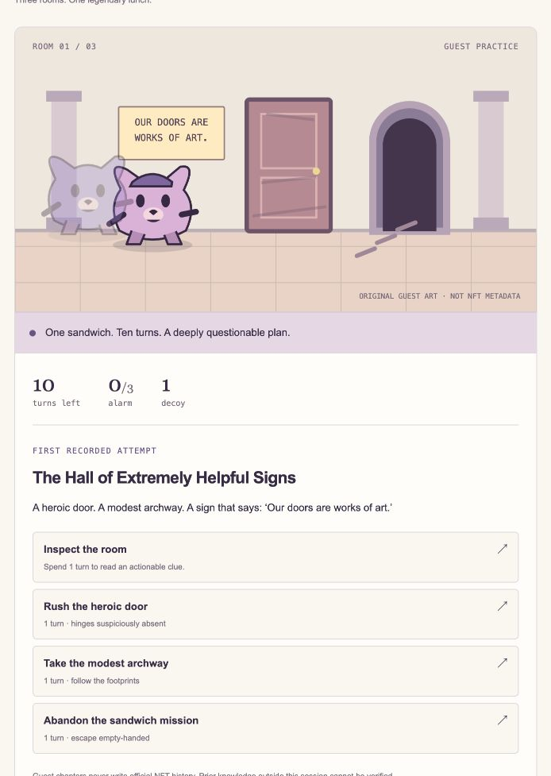

# First playable guest slice — October 10, 2026

**Private friend battles — October 14, 2026:** Challenge a friend sits beside practice. Two seats share an invitation, the existing combat engine resolves both hidden moves, and deadlines live in SQLite. Adventure routes stay available through `/archive`. Checks on October 14: 244 unit/integration tests passed and 1 skipped, four two-browser friend-battle flows, five practice combat flows and four landing/archive flows, plus format, lint, typecheck and production build. Desloppify objective 91.8, strict 21.8, 206 open; the strict score stays low because 20 subjective dimensions are unassessed. See [PRIVATE_PVP.md](PRIVATE_PVP.md). No internet or physical-device match was run.

**Arena presentation — October 13, 2026:** four cosmetic environments, a compact source-capped portrait field, authoritative contact feedback, original event-timed audio with remembered controls and selected-match asset preparation are implemented. 206 app tests and 57 distinct browser flows pass across full/focused runs; static checks and the production build pass. Verification and review evidence are in [the arena presentation report](ARENA_FEEL.md). The approved rendered artwork, Blender sources, saved records and combat rules remain preserved.

Approved rendered artwork restoration, **October 13, 2026**: all twelve families use the approved sculpted PNG designs, compact aligned near-lossless WebP pose exports, native CSS-size caps, isolated cells and small idle-only selection exports. Attack contact/terminal presentation and current notices remain authoritative. **200 app tests and 49 distinct browser flows pass across full/focused runs**, plus static checks/build; all twelve 3× portrait roster checks pass and are recorded in [the restoration report](ART_RESTORATION.md). The simplified Blender pilot remains editable but is not the default or approved direction. Saved battles, rules, identity/privacy, adventures and museum remain preserved; free movement is documentation only.

Latest playable Blender pilot, **October 13, 2026**: real editable Aegis/armadillo rigs/actions, transparent sampled clips and event-driven arena integration are implemented for this pair only, with original assets as loading fallback. **198 unit/integration tests, eight model checks, five rig checks and 46 distinct browser flows pass across full/focused runs**, plus static checks/build. [Source, reproduction, recordings, measurements and limits](BLENDER_ANIMATION_PILOT.md). Other eleven fighters, frozen rules/policies, ownership and private history remain intact. Model detail still differs from the approved artwork; further roster conversion requires visual/art/performance review.

Historical Latest combat presentation milestone, **October 12, 2026**: all twelve fighters now have distinct full-body anatomy, three-quarter combat faces and 24 different basic/special treatments. Easy/Medium/Hard freeze `combat-opponent/2` decision policies without changing `/1` combat stats/rules; old battles retain the labelled Legacy policy. **187 unit/integration tests and 38 production browser flows pass**, plus format/lint/type/build; the terminal-display correction also has a focused normal/reduced-motion/refresh regression. Actual gameplay recordings, the 192-case benchmark and limits are in [combat presentation evidence](COMBAT_PRESENTATION.md). Human playtesting, user-operated real-holder combat and unassessed Desloppify design review remain gates. Progression, configurable combat loadouts and combat ghost training remain unimplemented.

Latest character milestone, October 11: **119 unit/integration tests and 24 production browser flows pass**, plus format/lint/type/build. All twelve original tactical classes have authoritative abilities, persisted budgets/effects, ability-aware ghosts and frozen same-loadout challenges; verified-holder access and borrowed-class boundaries are tested with labelled synthetic fixtures. Legacy chapters and the real local saved state are preserved. Read [CHARACTERS.md](CHARACTERS.md) for exact evidence, quality findings, changed files and required real-holder manual steps. Earlier milestone counts below are historical.

Latest presentation milestone: **77 unit/integration tests and 13 production browser flows pass**, plus formatting, lint, typecheck and build. A new landing page and dedicated Play, Museum, My journal and My Chog routes. Shared app navigation preserves guest play; old bookmarks and challenge links remain supported. See [PAGES_AND_LANDING.md](PAGES_AND_LANDING.md).

Latest journal update: **77 unit/integration tests and nine production browser flows pass**, plus format/lint/type/build. Private saved chapters, selected historical ghost races and cohort-separated museum rematches are available under My journal. Existing active play was preserved. See [GUEST_JOURNAL.md](GUEST_JOURNAL.md) for current contracts, quality scores, remaining gaps and screenshot evidence. Older milestone counts below are historical.

Latest main-app update: **63 unit/integration tests and seven production browser flows pass**. Guest rematches now race a ghost frozen before the attempt, with a visual turn clock and independent lanes; museum replay shows both the recorded failure and its frozen strategy. Wallet work is parked. Read [GHOST_RACES.md](GHOST_RACES.md) for current implementation, command evidence, quality scores and limitations. The earlier milestone sections below are historical evidence, not current unimplemented-status claims.

Latest update: wallet sign-in is migrated to Privy. Read [PRIVY.md](PRIVY.md) for app/key setup, JWT verification, tests, dependency advisories and hosted-login limits. Current checks: 53 unit/integration tests and six production browser flows. The configured Privy wallet selector opens on port 3000; actual holder login/signing remains unobserved. Official rotating-key verification is enabled without an app secret. [IDENTITY.md](IDENTITY.md) preserves the earlier seven synthetic-wallet flows, live collection reads and token-history milestone evidence. Historical guest/design results below remain intact.

The local slice is playable at http://127.0.0.1:3000 while its production server is running. No public deployment was performed. README.md contains portable Node 24 setup and testing instructions.

## Implemented and tested

- **Adventure:** The Great Sandwich Incident, three authored rooms, ten turns, one decoy, visible clues, patrol timing, multiple winning routes, painted-door capture, alarm capture, empty escape and closing-time capture.
- **Authority:** clients submit actions and expected steps, never trusted scores. The Node service validates transitions, budgets and frozen rule/content versions. Unfinished responses omit scenario seed, replay, ghost and future patrol state. Official mode and fabricated owner fields are rejected at the request boundary.
- **Replay:** exact recorded actions yield the same game states. Unsupported rule versions fail validation. Replay is separate from a strategy ghost.
- **Doppelgänger:** completed validated runs create a frozen `habit-ranking/1` profile with observed support counts, private training references and an integrity digest. Supported inspection/door/decoy habits affect choices; unseen states use a documented visible-clue baseline. Ghost and player evaluate independently from identical starting states. Hashes do not prove fair play. No ML is used or claimed.
- **Museum:** only terminal failures can be published, with explicit consent, bounded title and public alias. Scenario, original actions and a ghost derived from that consented run alone are frozen. Challenge links work across independent browser sessions on the same server. Publication and repeated steps are idempotent; private session IDs/training references are excluded from public replay. Aliases render as text, including HTML-shaped test input.
- **Cohorts:** first recorded exposure is tracked conservatively per guest cookie and authored content/rules. Later play, different patrol seeds and viewing an exhibit's solution become informed retries. Cookie resets, other browsers and external knowledge remain unverifiable. There is no person-count claim or public leaderboard.
- **Persistence:** real SQLite transactions, WAL and a busy timeout; completed runs, ghost snapshots, exhibits and observed exposures survive database reopen. Author/session isolation, chosen-ID collision rejection and transaction rollback are tested. A dropped HTTP response can be retried without spending a second turn.
- **Withdrawal:** author session can withdraw its exhibit idempotently. Public replay and new challenge starts then return unavailable; an already-started private run can finish without the withdrawn comparison. Withdrawn records remain in the local database for reference maintenance. This is withdrawal, not deletion from backups or universal erasure. Losing the guest cookie requires local operator database maintenance for removal.
- **Presentation:** original geometric guest art, character-led room illustrations, responsive screens, accessible labels, keyboard controls, live consequence text and reduced-motion CSS. All ownership/artwork limitations are visible. No collection assets were copied.

The app remains a trusted local service. Guest session UUIDs are unguessable bearer identifiers held in HTTP-only, SameSite Strict cookies, not signed wallet identities. Requests enforce same origin, bounded JSON, strict schemas and a per-session request limit. Cookie reset can bypass that limit; broader abuse controls and retention/expiry maintenance are needed before public hosting. Data volume is not yet capped globally.

## Verification gates

Registration was confirmed by the founder in chat; application ID/receipt was not inspected. The public event and official product/portal were read without authentication. The exact final cutoff, official NFT collection/chain/standard, metadata stability, asset/IP permissions and real-holder access remain unverified. See [DECISIONS.md](DECISIONS.md) and [event evidence](EVENT_AND_SUBMISSION.md).

Official NFT authentication, allowlisted RPC ownership reads, nonce expiry/replay protection, ownership-generation/finality policy, transfer-away/back and reorg behavior, token-bound history, inherited public history and private-draft succession remain **unimplemented**. No test fixture is presented as a real holder integration. This preview is not yet an event-compliant full entry.

## Commands and results

Commands ran with bundled Node **24.19.0** on macOS. The host's default Node 25 is outside Vitest 5's engine range. Portable setup uses Node 24 via `.nvmrc`. Actual verification used:

```sh
PATH=/Users/apple/.cache/codex-runtimes/codex-primary-runtime/dependencies/node/bin:$PATH npm run format:check
PATH=/Users/apple/.cache/codex-runtimes/codex-primary-runtime/dependencies/node/bin:$PATH npm run lint
PATH=/Users/apple/.cache/codex-runtimes/codex-primary-runtime/dependencies/node/bin:$PATH npm run typecheck
PATH=/Users/apple/.cache/codex-runtimes/codex-primary-runtime/dependencies/node/bin:$PATH npm test
PATH=/Users/apple/.cache/codex-runtimes/codex-primary-runtime/dependencies/node/bin:$PATH npm run build
PLAYWRIGHT_BROWSERS_PATH=/tmp/chog-playwright PATH=/Users/apple/.cache/codex-runtimes/codex-primary-runtime/dependencies/node/bin:$PATH npm run test:e2e
```

| Check                   | Result                                             |
| ----------------------- | -------------------------------------------------- |
| Prettier                | Passed on authored source, tests and configuration |
| ESLint                  | Passed, no final lint warnings                     |
| TypeScript strict check | Passed                                             |
| Vitest                  | 21 tests passed across four suites                 |
| Next production build   | Passed; `/` static UI, `/api/game` Node route      |
| Chromium browser tests  | 3 passed against the production build              |

Unit/integration cases cover invalid/wrong-phase/terminal actions, all reachable legal paths and resource bounds, alternate routes, deterministic replay, unsupported versions, contrasting ghost histories, fallback, completed-only training, independent states, frozen versions, actor isolation, cross-session run-ID collisions, consent, HTML-shaped aliases, duplicate steps/publication, frozen challenge equality, exposure/retry labels, withdrawal, database reopen, transaction rollback, rate limits, JSON size/content, origin/session requirements and guest rejection of official writes.

The three browser checks cover:

1. Failure → exact replay → consent → publish → independent browser challenge → win/comparison → refresh → informed retry → withdrawal/unavailable link. HTML-shaped alias remains literal text; no page errors.
2. A second winning route at 390×844, keyboard start/advance, reduced motion and no horizontal overflow.
3. A real step commits to the service, its response is deliberately dropped, and retry/reload retains exactly nine turns after one inspection.

Chromium was installed in temporary storage, not vendored. E2E data lives in ignored `test-results/`, separately from the development museum. A separate agent-operated in-app-browser inspection started one labelled guest run with no actions yet in the development database. That is QA, not human user feedback or adoption. Desktop browser checks used Playwright's default viewport; the in-app preview used its existing narrower viewport.

Initial exhaustive testing caught and fixed vent overspending and a missing hall abandon option. Service review caught and fixed cross-session chosen-ID overwrite. Browser QA caught an ambiguous alert selector caused by Next's invisible route announcer; the corrected check verifies the actual withdrawal message. No implementation failure remains in the executed tests.

## Desloppify evidence

Desloppify 1.0 was available before coding. `.desloppify/` was already in `.gitignore`; the folder has no Git repository, and no repository/branch/commit/push was created. Initial scan ran after the meaningful pure-engine slice, then status/next were read before expanding. Follow-up scans covered the same project boundary. Obvious dependency/build/test/database outputs were excluded; authored engine, API, UI, content and tests were retained.

```sh
PATH="$PWD/node_modules/.bin:/Users/apple/.cache/codex-runtimes/codex-primary-runtime/dependencies/node/bin:$PATH" desloppify --lang typescript --exclude node_modules --exclude .next --exclude coverage --exclude test-results --exclude playwright-report --exclude data/local scan --path . --no-badge
desloppify status
desloppify next
```

| Scan                            | Overall / lenient | Strict | Objective | Verified |
| ------------------------------- | ----------------: | -----: | --------: | -------: |
| Initial engine                  |              24.5 |   24.5 |      97.9 |     97.9 |
| First integrated slice          |              19.8 |   19.8 |      79.3 |     79.3 |
| Final slice / confirming rescan |              19.9 |   19.6 |      79.6 |     79.6 |

All scores are scanner outputs, not an endorsement of complete quality. The target has **not** been achieved. Expanding to route-based UI lowered the scanner's test-health metric; it does not recognize the real browser flows as import-linked component unit tests. Browser tests exercise those screens, but do not cover every branch in isolation.

| Mechanical dimension | Initial health / strict | Integrated health / strict | Final health / strict |
| -------------------- | ----------------------: | -------------------------: | --------------------: |
| Code quality         |             95.5 / 95.5 |                95.5 / 94.9 |           97.8 / 95.3 |
| Duplication          |               100 / 100 |                  100 / 100 |             100 / 100 |
| File health          |               100 / 100 |                  100 / 100 |             100 / 100 |
| Security             |               100 / 100 |                99.2 / 99.2 |            100 / 99.4 |
| Test health          |               100 / 100 |                49.7 / 49.7 |           46.1 / 46.1 |

All 20 subjective dimensions remain **unassessed**, represented as zero by the tool in every scan. A review packet was prepared, but no assessments were imported or fabricated. The full subjective review is still the next queue item.

| Subjective dimension      | Initial | Integrated | Final | State      |
| ------------------------- | ------: | ---------: | ----: | ---------- |
| Abstraction fit           |       0 |          0 |     0 | Unassessed |
| AI generated debt         |       0 |          0 |     0 | Unassessed |
| API coherence             |       0 |          0 |     0 | Unassessed |
| Authorization consistency |       0 |          0 |     0 | Unassessed |
| Contracts                 |       0 |          0 |     0 | Unassessed |
| Convention consistency    |       0 |          0 |     0 | Unassessed |
| Cross-module architecture |       0 |          0 |     0 | Unassessed |
| Dependency health         |       0 |          0 |     0 | Unassessed |
| Design coherence          |       0 |          0 |     0 | Unassessed |
| Error consistency         |       0 |          0 |     0 | Unassessed |
| High elegance             |       0 |          0 |     0 | Unassessed |
| Incomplete migration      |       0 |          0 |     0 | Unassessed |
| Initialization coupling   |       0 |          0 |     0 | Unassessed |
| Logic clarity             |       0 |          0 |     0 | Unassessed |
| Low elegance              |       0 |          0 |     0 | Unassessed |
| Mid elegance              |       0 |          0 |     0 | Unassessed |
| Naming quality            |       0 |          0 |     0 | Unassessed |
| Package organization      |       0 |          0 |     0 | Unassessed |
| Test strategy             |       0 |          0 |     0 | Unassessed |
| Type safety               |       0 |          0 |     0 | Unassessed |

The final scan has **39 open items**: 20 assessment requests, 10 import-linked test warnings, 8 smells and one orphan warning for the CLI-loaded Playwright config. No open security finding remains. Remaining smells include the session hook's complexity/nested closures, illustration color literals, URLs in test/config files, a return-only test-input factory, numeric timing and an error logger that the detector does not associate with the following 503 return. These remain visible; none were suppressed, excluded as authored code, marked wontfix, or cosmetically rewritten to inflate scores.

Real change-related risks resolved include resource underflow, cross-session overwrite, local malformed JSON handling, non-null access, overly large page function, and a stylesheet mixing game, result and museum concerns. Styles and views now follow those responsibilities. The final confirming scan is unchanged. The scanner still carries a gap between health/strict on resolved items; reported numbers above are unaltered.

Tool limits: the initial duplication check failed before local `jscpd` was installed; subsequent duplication checks ran. Desloppify invokes the removed `next lint` command, so its framework-lint detector reports reduced coverage. Next's [official installation documentation](https://nextjs.org/docs/app/getting-started/installation) instructs using ESLint directly; that separate check passed. The tool was not modified, and no unauthorized upstream issue/PR was posted.

## Provenance and next gate

Original game code, dialogue, geometric art and CSS were authored here with AI assistance. No code/assets were taken from Recourse, Reviso, Nigemichi or unrelated projects. Existing concept planning predates this build and must be disclosed. No testimonial, usage, retention or winner metrics were invented. No consenting human usability session has been conducted.

Direct runtime dependencies: Next 16.4.0, React/React DOM 19.3.0 and Zod 4.6.5 (MIT). Test/tool dependencies: TypeScript 6.0.3 and Playwright 1.64.0 (Apache-2.0); Vitest 5.0.3, Prettier 3.9.10, ESLint 9.39.5, eslint-config-next 16.4.0 and jscpd 5.4.1 (MIT). The lockfile pins transitive versions; retain their package licenses when redistributing. Type declarations use their installed license terms. Initial TypeScript 7 could compile but was incompatible with typescript-eslint, so TypeScript 6 is pinned. ESLint 9 was installed by the compatible package resolution and carries a deprecation notice; review its upgrade alongside the next dependency-health gate rather than claiming all dependencies are indefinitely supported.

Next: obtain definitive collection/chain/standard and IP sources plus a consenting real holder; implement ownership/authentication/succession with explicit finality and generation policy. In parallel scope, gather real consenting human play feedback, complete the subjective review and investigate the remaining UI/test warnings. Public hosting, deployment, submission, wallet signing and transactions require their existing authorization gates. No paid service was selected or called.




## October 14, 2026 — animated Sanctuary and battle readiness

Implemented a faithful ten-second silent Sanctuary loop with separate atmosphere/foliage/light layers, compressed desktop/portrait H.264 exports and existing poster fallback. The user subsequently requested automatic playback with no visible scene controls; the final local preview follows that direction and retains static motion/data-saving preferences and hidden/offscreen resource handling.

Selected match atlases retain all cells/dimensions/pivots and exact alpha, with quality-94 RGB encodings and original/legacy fallbacks. Stable setup preparation is cancellable, full-size roster idle fetches become lazy thumbnails, decoded retention has a 48 MiB estimate budget, optional sound never gates artwork, and failed required actors have same-save retry. No balance, engine, auth, ownership, history, save schema, free movement or Blender changes.

Fresh three-run production medians at 390×844/DPR3/6×CPU/1.6 Mbps/150ms: Play→battle 19.266→8.023s; Start→battle 18.258→6.853s; direct guest 13.299→8.444s; Aegis/Ember 22.871→11.795s. Landing 2.161→2.190s. Five seconds remains unmet. Full samples, initial/deferred bytes, source-quality tradeoffs, actual complete battle and limitations: [CINEMATIC_READINESS.md](CINEMATIC_READINESS.md).

Verification: 226 app tests/44 files pass, one optional live RPC skipped; 47 browser cases across full/focused production runs, including all twelve portrait families and corrected normal/reduced-motion readiness, with 18 final control-free cases passing. Format/lint/type/build and HyperFrames check pass. Desloppify same-boundary scan/status/next: overall22.8/objective91.1/strict21.6/verified91.1, 191 open; 20 subjective dimensions unassessed, strict85 target unmet. No suppressions/new exclusions, subagents, dependencies, paid services, commits, pushes or deployments. Local preview remains on port3000.


## October 14, 2026 — hero home-navigation playback repair

Reproduced the active hero becoming a permanent poster after clicking the home link on `/`: the generic cleanup latched a navigation that did not unmount the page. Restricting cleanup to actual same-origin/current-tab pathname changes preserves same-page/modifier/download/alternate-target playback. In-app video time advanced across the repaired logo click. No artwork/video changes or scene controls were added. 226 app tests, eight focused production browser cases, format/lint/type/build pass. Same-boundary Desloppify scan/status/next completed; strict21.6 remains below85 with20 subjective dimensions pending. See [repair evidence and limits](HERO_PLAYBACK_FIX.md).
# October 14, 2026 — make landing motion visible

The user still perceived a static hero after the navigation repair. The encoded movie did animate, but the motion was faint, largely outside the portrait crop and attenuated by the page shade. Strengthened faithful mist/light/cloud layers and added staggered gold motes/sparse petals within that crop; original painting, stonework, fixed camera and branding stay intact. Versioned v2 media replaces the older URL, with no scene controls. Desktop video 592,457 bytes, portrait321,905; previous exports retained.

226 app tests and ten focused browser cases pass, plus the final desktop/3× portrait visible-motion recording rerun, formatting/lint/type/build and HyperFrames runtime/layout checks. Desloppify before/after completes; strict21.6 remains, with20 unassessed dimensions; the new test's fixed-URL finding was corrected and auto-resolved. Existing tactical transitive-coverage classification varies; no open finding targets the new test. Actual page recordings, frame/pixel comparisons, media memory estimates, commands and limitations: [visible motion report](VISIBLE_HERO_MOTION.md). Local preview refreshed at port3000; no gameplay/save/identity change, dependencies, commits, pushes or deployment.

# October 14, 2026 — whole-building and cliff motion

Current user direction supersedes the earlier locked-camera brief. The complete approved painted world now glides along one smooth periodic camera path (±18px horizontal / ±6px vertical, constant 1.07 overscan). Buildings, floating cliffs and ground move together without changing their geometry; copy and controls stay fixed. Mist/particles retain local motion. Original masters and earlier exports remain available; this is camera motion over rendered artwork, not independently rigged cliffs.

Encoded-frame patch tracking confirms the same 36px movement in a stone column, floating cliff and ground ring. Ten focused browser cases pass on desktop/3× portrait, alongside 226 app tests, format/lint/type/build and HyperFrames runtime/layout checks. Desloppify scan/status/next complete: strict21.6; objective91.1→91.2 with existing tactical coverage classification variability; twenty subjective dimensions remain unassessed. Versioned v3 media is 2,119,766 bytes desktop / 787,207 portrait. [Actual page recordings, frame evidence, costs, limitations and commands](WORLD_HERO_MOTION.md). Updated local preview runs on port3000. Gameplay, saves, identity and source artwork remain preserved; no dependencies, commits, pushes or deployment.

